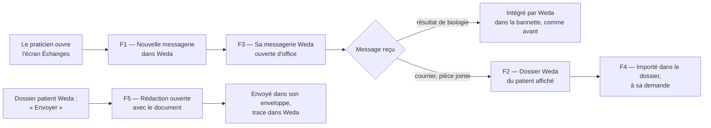

# E019 — Intégration de la nouvelle messagerie dans Weda

> **Statut** : 🟡 En cours — 2 fonctionnalités sur 5 validées, 3 livrées côté messagerie
> **Modèle** : task-driven
> **Version** : 1.8
> **Auteur** : PO forge
> **Audience** : PO, direction, équipe produit — la vue ingénierie vit dans [E019-Changelogs.md](E019-Changelogs.md)
> **Dernière mise à jour** : 2026-10-18

---

<!-- toc:start — section générée par /tech-writer ; ne pas éditer manuellement -->

## Sommaire

- [1. Vision](#1-vision)
- [2. Objectifs métier](#2-objectifs-métier)
- [3. Acteurs concernés](#3-acteurs-concernés)
- [4. Features de l'EPIC](#4-features-de-lepic)
- [5. Workflow entre Features](#5-workflow-entre-features)
- [6. Règles métier transverses](#6-règles-métier-transverses)
- [7. Contraintes et hypothèses](#7-contraintes-et-hypothèses)
- [8. Critères d'acceptation de l'EPIC](#8-critères-dacceptation-de-lepic)
- [9. Hors périmètre](#9-hors-périmètre)
- [État de couverture (2026-10-11)](#état-de-couverture-2026-10-11)
- [Synthèse fonctionnelle des changelogs](#synthèse-fonctionnelle-des-changelogs)

<!-- toc:end -->

---

## 1. Vision

Le praticien Weda traite aujourd'hui sa messagerie sécurisée de santé dans l'écran Échanges. Cet
EPIC y installe la **nouvelle messagerie** : il y lit, trie et répond à ses messages, **sans se
reconnecter et sans quitter Weda**, dans la boîte que Weda connaît.

Quand il le décide, il **importe un document reçu dans le dossier patient Weda**, en quelques clics.
La réception, et l'arrivée des résultats de biologie dans la bannette, restent assurées par Weda,
comme aujourd'hui.

Le praticien passe librement de l'écran actuel à la nouvelle messagerie.

---

## 2. Objectifs métier

- [ ] Objectif 1 : que le praticien lise et traite sa messagerie sécurisée dans Weda avec la
      nouvelle expérience, sans seconde connexion, dans la boîte que Weda connaît.
- [ ] Objectif 2 : qu'un document reçu soit importé dans le bon dossier patient quand le praticien
      le demande, sans jamais créer ni modifier une identité patient à son insu.
- [ ] Objectif 3 : que la nouvelle messagerie ne change rien à la réception : aucun résultat de
      biologie n'est perdu ni reçu en double.
- [ ] Objectif 4 : que le praticien puisse revenir à l'écran actuel à tout moment, sans perte.

---

## 3. Acteurs concernés

| Acteur | Rôle dans l'EPIC |
|---|---|
| Médecin / praticien | Utilisateur principal : lit, trie, répond, importe ses documents dans le dossier patient |
| Secrétariat médical | Conserve l'écran actuel dans cette première version |
| Cabinet | Unité d'activation : la nouvelle messagerie est proposée cabinet par cabinet |
| Exploitation de l'éditeur | Active l'intégration cabinet par cabinet, et peut la désactiver |

---

## 4. Features de l'EPIC

> Le bilan d'avancement par feature (statut, couverture, tasks contributives) est consigné en fin
> de document, dans la section *État de couverture*.

| Fonctionnalité | Ce que le praticien peut faire | Tasks | Statut |
|---|---|---|---|
| **F1 — La nouvelle messagerie dans l'écran Échanges** | Ouvrir sa messagerie dans Weda sans se reconnecter. Elle ne dialogue avec le dossier patient que si l'intégration est activée pour son cabinet. | task-356 | 🟢 Validée, en attente de mise en ligne |
| **F2 — Le dossier Weda du patient d'un document reçu** | Voir, sous un message, le dossier Weda du patient concerné (trouvé par son INS), ou des correspondances possibles à vérifier, puis l'ouvrir en un clic. | task-357 | 🟢 Validée, en attente de mise en ligne |
| **F3 — La messagerie que Weda connaît, ouverte d'office** | Retrouver dans Weda la messagerie que Weda connaît, même s'il en a choisi une autre par défaut. Si elle n'est pas encore rattachée à son compte, la rattacher, l'adresse déjà saisie. Passer ensuite librement à ses autres messageries. | task-362 | 🟡 Livrée côté messagerie, partie Weda à réaliser |
| **F4 — Importer un document reçu dans le dossier patient** | Importer, quand il le décide, une pièce jointe, le document d'un compte rendu ou le message lui-même dans le dossier d'un patient : destination, classification, commentaire, post-it. Le message reste dans sa boîte de réception. | task-363, task-372 | 🟡 Livrée côté messagerie, partie Weda à réaliser |
| **F5 — Envoyer un document du dossier patient** | Envoyer un document du dossier Weda par la nouvelle messagerie, dans l'enveloppe qu'attendent les messageries de santé. Weda garde la trace de l'envoi. | task-366, task-367, task-372 | 🟡 Livrée côté messagerie, partie Weda à réaliser |

---

## 5. Workflow entre Features

1. Le praticien ouvre l'écran Échanges : la nouvelle messagerie s'affiche, sans nouvelle connexion
   (F1).
2. Elle s'ouvre sur la messagerie que Weda connaît (F3). Il peut ensuite passer à une autre de ses
   messageries.
3. Un résultat de biologie rejoint la bannette par la réception de Weda, comme aujourd'hui. La
   nouvelle messagerie ne l'importe pas.
4. Pour un courrier ou une pièce jointe, il voit le dossier Weda du patient concerné (F2). Il y
   importe le document quand il le décide (F4), et le message reste dans sa boîte de réception.
5. Depuis le dossier d'un patient, « Envoyer » ouvre la rédaction de la nouvelle messagerie avec le
   document (F5). Il part dans l'enveloppe qu'attendent les messageries de santé, et Weda garde la
   trace de l'envoi.

---

## 6. Règles métier transverses

| Règle | Énoncé | Statut |
|---|---|---|
| RG-E019-01 | Weda reste seul à écrire dans le dossier patient : la nouvelle messagerie demande, Weda vérifie les droits du praticien et importe | 🟡 Tenue côté messagerie, import côté Weda à réaliser (task-363) |
| RG-E019-02 | Aucune identité patient n'est créée ni modifiée depuis la nouvelle messagerie. Seule l'INS vérifiée désigne un dossier d'office ; un rapprochement par nom, prénom et date de naissance reste une proposition à vérifier | 🟡 Tenue côté messagerie : à l'import, seul un dossier trouvé par INS vérifiée est présélectionné, sinon le praticien choisit (task-363) |
| RG-E019-03 | L'intégration s'active cabinet par cabinet, par un interrupteur fermé tant qu'il n'a pas été explicitement ouvert | ✅ Tenue (task-356) |
| RG-E019-04 | Hors de Weda (onglet séparé, autre navigateur), la nouvelle messagerie ne propose aucune action sur le dossier patient | ✅ Tenue (task-356) |
| RG-E019-05 | Les résultats de biologie restent intégrés par Weda seul, à la réception : la nouvelle messagerie n'en importe aucun, et importer un document ne déplace ni ne supprime le message | 🟡 Tenue côté messagerie : pas d'import pour la biologie, le message reste en place (task-363) |
| RG-E019-06 | Aucune donnée de santé (identité, INS, contenu de document) n'apparaît dans les journaux | ✅ Tenue (task-356) |
| RG-E019-07 | Dans Weda, la nouvelle messagerie s'ouvre toujours sur la messagerie que Weda connaît ; le praticien passe ensuite librement à ses autres messageries | 🟡 Tenue côté messagerie, partie Weda à réaliser (task-362) |

---

## 7. Contraintes et hypothèses

### Contraintes
- La structure de la base de données de Weda ne change pas.
- La réception reste celle d'aujourd'hui : Weda relève la boîte, intègre les résultats de biologie
  dans la bannette et range les messages dans l'écran actuel. La nouvelle messagerie ne la remplace
  pas.
- La messagerie sécurisée de santé exige la connexion Pro Santé Connect du praticien. La réception
  se fait donc tant qu'une page de Weda est ouverte, comme aujourd'hui.
- Importer un document ne déplace ni ne supprime le message. La réception de Weda ne lit que la
  boîte de réception : un message sorti trop tôt priverait la bannette d'un résultat de biologie.

### Hypothèses
- Le praticien a une boîte connue de Weda, et c'est elle que la nouvelle messagerie ouvre. Un compte
  peut en porter plusieurs : il passe ensuite de l'une à l'autre librement.
- Le praticien est seul titulaire de sa boîte ; le secrétariat reste sur l'écran actuel dans cette
  première version.

---

## 8. Critères d'acceptation de l'EPIC

- [ ] Toutes les features de l'EPIC sont livrées
- [x] Un praticien connecté à Weda ouvre la nouvelle messagerie sans se reconnecter
- [ ] Dans Weda, la nouvelle messagerie s'ouvre sur la boîte que Weda connaît, même si le praticien
      en a choisi une autre par défaut
- [ ] Un document importé depuis la nouvelle messagerie apparaît dans le dossier patient comme s'il
      avait été classé depuis l'écran actuel
- [ ] Pendant le pilote, les résultats de biologie arrivent dans la bannette comme avant, sans perte
      ni doublon
- [ ] Le praticien revient à l'écran actuel à tout moment, sans perte de message

---

## 9. Hors périmètre

- La création d'un dossier patient à partir d'un document reçu, et la vérification d'identité par le
  téléservice INSi depuis la nouvelle messagerie : elles restent dans l'écran actuel pour cette
  première version.
- Le classement automatique, sans geste du praticien, des documents dont l'identité est vérifiée.
- La réception par la nouvelle messagerie, et l'intégration des résultats de biologie et des
  messages HPRIM : elles restent à Weda. Le mode où la nouvelle messagerie remplacerait l'écran
  actuel pour tout un cabinet, étudié le 2026-10-09, est en attente.
- Le compteur de messages non lus de l'en-tête de Weda, et l'envoi d'un document depuis le dossier
  patient : ils restent ceux de l'écran actuel.
- Les messageries MSSanté de première génération et Medimail, qui conservent l'écran actuel.
- L'usage de la nouvelle messagerie en dehors de Weda pour agir sur le dossier patient.

---

## État de couverture (2026-10-11)

| Feature | Statut | Couverture | Tasks contributives |
|---|---|---|---|
| F1 — La nouvelle messagerie dans l'écran Échanges | 🟢 Validée, en attente de mise en ligne | affichage dans Échanges, connexion sans ressaisie, activation par cabinet, rien hors de Weda | task-356 |
| F2 — Le dossier Weda du patient d'un document reçu | 🟢 Validée, en attente de mise en ligne | dossier trouvé par INS vérifiée, correspondances signalées « à vérifier », ouverture du dossier en un clic dans Weda | task-357 |
| F3 — La messagerie que Weda connaît, ouverte d'office | 🟡 Livrée côté messagerie, partie Weda à réaliser | ouverture d'office sur la messagerie désignée à chaque entrée, rattachement proposé avec l'adresse déjà saisie, comportement inchangé hors de Weda | task-362 |
| F4 — Importer un document reçu dans le dossier patient | 🟡 Livrée côté messagerie, partie Weda à réaliser | fenêtre d'import (patient, documents, destination, classification, commentaire, post-it), message laissé en place, aucune action pour la biologie ; présélection seulement si tous les documents désignent le même patient, pièces de même nom importées chacune, compte rendu propre au message | task-363, task-372 |
| F5 — Envoyer un document du dossier patient | 🟡 Livrée côté messagerie, partie Weda à réaliser | rédaction ouverte depuis le dossier avec destinataire et document, signalé « Données structurées » ; enveloppe construite à l'envoi (compte rendu PDF ou synthèse structurée, patient désigné par son INS) ; auteur vérifié ; avis d'envoi à Weda pour sa trace, limité aux documents réellement partis ; message clair si l'intégration est indisponible ; abandon sans envoi ni brouillon | task-366, task-367, task-372 |

**Couverture EPIC consolidée : 70 %** (2 fonctionnalités sur 5 validées, 3 livrées côté messagerie).

---

## Synthèse fonctionnelle des changelogs

### Fonctionnalités métier

- v1.0 — La nouvelle messagerie s'affiche dans l'écran Échanges de Weda. Le praticien déjà
  connecté à Weda y entre directement, sans nouvelle connexion (task-356).

- v1.1 — Sous chaque message qui contient un document médical, le praticien voit le dossier Weda du
  patient concerné, trouvé par son INS vérifiée. À défaut, il voit des correspondances possibles,
  signalées « à vérifier ». Il ouvre le dossier en un clic dans Weda (task-357).

- v1.2 — Dans Weda, la nouvelle messagerie s'ouvre à chaque entrée sur la messagerie que Weda
  connaît, même si le praticien en a choisi une autre par défaut. Si elle n'est pas encore
  rattachée à son compte, l'écran de rattachement le lui annonce, l'adresse déjà saisie. Une fois
  la messagerie ouverte, il passe librement à ses autres messageries. Ouverte hors de Weda, la
  nouvelle messagerie ouvre toujours sa messagerie par défaut (task-362).

- v1.3 — « Importer dans Weda » : depuis un message reçu, le praticien importe, quand il le décide,
  le compte rendu, une pièce jointe ou le message lui-même dans le dossier d'un patient. Pour
  chaque document, il choisit le titre, la destination (Consultation, Examen, Courrier), la
  classification et un commentaire, et peut ajouter un post-it pour un confrère. Le message
  reste dans sa boîte de réception, et un second import reste possible. Un compte rendu de
  biologie ne propose pas d'import : Weda l'intègre lui-même dans la bannette des résultats
  (task-363).

- v1.4 — Préparation de l'envoi depuis le dossier patient : un document de Weda pourra partir par la nouvelle
  messagerie dans l'enveloppe qu'attendent les messageries de santé. Un compte rendu en PDF y est placé dans un document
  médical conforme, et une synthèse déjà structurée y part sans aucune retouche. Le patient y est désigné par son INS, et
  chaque destinataire est nommé. L'envoi depuis Weda arrive avec la fonctionnalité suivante (task-366).

- v1.5 — Envoyer un document du dossier patient : depuis le dossier d'un patient dans Weda, « Envoyer » ouvre la
  rédaction de la nouvelle messagerie avec le destinataire et le document, signalé « Données structurées ». À l'envoi,
  la messagerie place le document dans son enveloppe de messagerie de santé : un compte rendu PDF part accompagné de
  l'enveloppe, une synthèse structurée part dans l'enveloppe seule. Weda est prévenu de l'envoi et en garde la trace
  dans le dossier. Fermer la rédaction n'envoie rien et ne laisse aucun brouillon. Un envoi qui attend la carte du
  praticien construit l'enveloppe au moment où il part (task-367).

- v1.7 — Naviguer dans Weda ne fait plus tomber la messagerie : changer de page ne multiplie plus les connexions à la
  messagerie sécurisée, que la limite de l'opérateur MSSanté aurait fini par bloquer (« boîte momentanément
  indisponible »). Quand le praticien se déconnecte de Weda, la nouvelle messagerie ouverte dans un autre onglet le
  constate dès son retour sur l'onglet, ou en moins d'une minute, et revient à l'écran de connexion (task-365).

- v1.8 — L'import dans le dossier Weda dit vrai : deux pièces jointes de même nom sont importées chacune avec son propre
  contenu ; le compte rendu d'un import ne reste plus affiché sur le message suivant ; changer de message referme la
  fenêtre d'import. Après un échec ou un délai dépassé, le praticien est invité à vérifier le dossier avant de
  réessayer, une partie des documents ayant pu être classée. Depuis le dossier Weda, si la nouvelle messagerie ne peut
  pas joindre Weda, elle le dit et renvoie vers l'ancien écran d'envoi, au lieu de ne rien faire (task-372).

### Sécurité

- v1.0 — La nouvelle messagerie ne dialogue avec Weda que si l'intégration a été explicitement
  activée pour le cabinet, et jamais lorsqu'elle est ouverte en dehors de Weda. Weda n'accepte les
  demandes que de la messagerie qu'il affiche lui-même (task-356).
- v1.1 — Aucune identité patient n'est créée ni modifiée depuis la nouvelle messagerie. La recherche
  du dossier reste limitée au cabinet du praticien (task-357).
- v1.2 — Désigner une messagerie n'accorde aucun droit : seule une messagerie déjà rattachée au
  compte du praticien s'ouvre, et le rattachement reste soumis à son identité Pro Santé Connect.
  L'adresse de la messagerie n'est conservée qu'à l'écran, jamais dans l'adresse de la page ni dans
  les journaux (task-362).
- v1.3 — L'import ne vise qu'un dossier existant. Seul un dossier trouvé par INS vérifiée est
  proposé d'office ; une correspondance par nom, prénom ou date de naissance doit être choisie
  par le praticien. Aucune identité n'est créée ni modifiée, et Weda revérifie que le patient
  appartient au cabinet (task-363).
- v1.4 — Une enveloppe n'est jamais produite à moitié : une information manquante (INS du patient, identifiant du
  praticien ou de la structure, type du document) l'arrête, et une synthèse qui ne porte pas l'INS du patient annoncé
  est refusée. Rien n'est écrit sur le disque, et aucune donnée de santé n'apparaît dans les journaux (task-366).
- v1.5 — L'enveloppe ne peut désigner comme auteur que le praticien qui envoie : un autre auteur est refusé et rien ne
  part. Une donnée manquante est nommée au praticien, jamais sa valeur. Les copies cachées ne figurent pas dans
  l'enveloppe. Les journaux ne portent ni INS, ni nom, ni nom de fichier. L'avis envoyé à Weda ne porte que le
  patient, les documents et les adresses des destinataires, et Weda revérifie que chaque document appartient au
  patient et au cabinet (task-367).
- v1.6 — La nouvelle messagerie déployée parle à la messagerie sécurisée de **son propre** environnement : si sa
  configuration est incomplète, elle refuse de démarrer au lieu de se rabattre sur des valeurs de test. Seule
  l'adresse exacte de Weda peut l'embarquer et dialoguer avec elle ; un autre site, même sous `weda.fr`, ne le peut
  plus (task-369).
- v1.7 — Sur un poste partagé, la nouvelle messagerie ne montre jamais la messagerie d'un praticien à celui qui s'est
  connecté après lui : elle se recharge sur la session du nouveau praticien. Une déconnexion de Weda la fait quitter,
  même ouverte dans un autre onglet (task-365).
- v1.8 — Identito-vigilance de l'import : un dossier n'est proposé d'office que si **tous** les documents du message
  désignent, par INS vérifiée, le même patient ; pour un message portant les documents de plusieurs patients, rien
  n'est choisi ni coché à la place du praticien, et choisir un patient coche ses seuls documents. Une réponse tardive
  d'une fenêtre fermée ne modifie jamais la fenêtre suivante. La trace « document envoyé » écrite par Weda ne cite que
  les documents réellement partis ; un envoi différé (à confirmer par la carte, ou mis en file) n'en écrit pas,
  limite décidée et assumée (task-372).

---

*Document vivant — maintenu par /tech-writer à partir des task files déclarant `**Epic**: E019`.*
