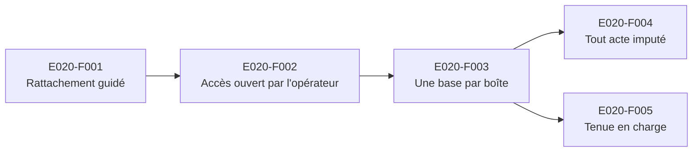

# E020 — Boîte partagée : une base par boîte, tout acte imputé

> **Statut** : 🟢 Livrée — 6 fonctionnalités sur 6, en attente de recette ; correctifs d'audit en cours (task-410 à 415)
> **Modèle** : task-driven
> **Version** : 1.10
> **Auteur** : PO forge
> **Audience** : PO, direction, équipe produit — la vue ingénierie vit dans [E020-Changelogs.md](E020-Changelogs.md)
> **Dernière mise à jour** : 2026-10-30

---

<!-- toc:start — section générée par /tech-writer ; ne pas éditer manuellement -->

## Sommaire

- [1. Vision](#1-vision)
- [2. Objectifs métier](#2-objectifs-métier)
- [3. Acteurs concernés](#3-acteurs-concernés)
- [4. Features de l'EPIC](#4-features-de-lepic)
- [5. Workflow entre Features](#5-workflow-entre-features)
- [6. Règles métier transverses](#6-règles-métier-transverses)
- [7. Contraintes et hypothèses](#7-contraintes-et-hypothèses)
- [8. Critères d'acceptation de l'EPIC](#8-critères-dacceptation-de-lepic)
- [9. Hors périmètre](#9-hors-périmètre)
- [État de couverture (2026-10-28)](#état-de-couverture-2026-10-28)
- [Synthèse fonctionnelle des changelogs](#synthèse-fonctionnelle-des-changelogs)

<!-- toc:end -->

---

## 1. Vision

Plusieurs professionnels travaillent souvent sur une même messagerie sécurisée : le titulaire et
ceux à qui il délègue, ou les praticiens d'un cabinet sur l'adresse de la structure. Cet EPIC leur
donne **une seule boîte partagée** : tous voient les mêmes messages, les mêmes rattachements patient
et les mêmes acquittements, sans copie des données de santé par personne.

L'accès reste entre les mains de l'**opérateur MSSanté**, qui l'ouvre et le ferme. **Chaque acte est
tracé au nom de la personne qui l'a fait.** Si un délégataire supprime un message de la boîte du
titulaire, le journal dit que c'est le délégataire qui l'a supprimé.

> Cadre : règle de partage des boîtes réécrite le 2026-10-28, après le retrait par l'ANS de l'espace
> partagé des messageries déléguées. Le délégataire ouvre désormais la boîte du délégant avec sa
> propre connexion Pro Santé Connect.

---

## 2. Objectifs métier

- [ ] Une boîte, une seule source de vérité : ce qu'une personne fait est vu de toutes les autres.
- [ ] Aucune copie des données de santé d'une boîte chez une autre personne.
- [ ] Le rôle de chacun (titulaire, membre, délégataire) vient de l'Annuaire Santé, jamais d'une
      déclaration de la personne.
- [ ] Un accès refusé ou révoqué par l'opérateur ferme immédiatement la boîte, données déjà
      présentes comprises.
- [ ] Chaque acte est imputable nominativement à son auteur, et lisible par toutes les personnes de
      la boîte.

---

## 3. Acteurs concernés

| Acteur | Rôle dans l'EPIC |
|--------|------------------|
| Titulaire | Professionnel dont l'Annuaire Santé publie la boîte personnelle. Seul à garder la lecture hors ligne. |
| Membre | Professionnel d'une structure dont l'Annuaire publie l'adresse organisationnelle. Une telle adresse n'a pas de titulaire. |
| Délégataire | Professionnel à qui le titulaire a délégué sa boîte. Il la rattache en saisissant l'adresse. |
| Opérateur MSSanté | Ouvre, refuse ou révoque l'accès d'une personne à une adresse. |
| Annuaire Santé | Publie les boîtes de chaque professionnel. Fait foi sur le rôle de titulaire ou de membre. |
| Responsable conformité, DPO | Lit le journal des actes ; veille à l'imputabilité des accès aux données de santé. |

---

## 4. Features de l'EPIC

| # | Fonctionnalité | Ce que le praticien peut faire | Tasks | Statut |
|---|---|---|---|---|
| E020-F001 | Rattachement guidé par l'Annuaire Santé | Choisir ses boîtes dans la liste « Mes boîtes » publiée pour lui, ou ajouter une boîte qui lui est déléguée ; voir son rôle sur chaque boîte ; avec une carte de test, retrouver sa boîte de test ; trouver, dès le rattachement, son nom d'expéditeur et sa signature préremplis | task-402, task-408, task-409 | 🟢 Livrée, en attente de recette |
| E020-F002 | Accès ouvert par l'opérateur | Ne lire une boîte que si l'opérateur lui en a ouvert l'accès récemment ; le titulaire seul garde la lecture hors ligne | task-403 | 🟢 Livrée, en attente de recette |
| E020-F003 | Une base par boîte | Travailler à plusieurs dans la même boîte : rattachements patient, étiquettes, acquittements et classements partagés ; réglages et signatures restent personnels | task-404, task-410 | 🟢 Livrée, en attente de recette |
| E020-F004 | Tout acte imputé à son auteur | Lire, dans le journal de la boîte, qui a fait quoi, quand et sur quel objet | task-405 | 🟢 Livrée, en attente de recette |
| E020-F005 | Tenue en charge d'une boîte partagée | Garder une messagerie réactive quand plusieurs personnes travaillent dans la même boîte | task-406 | 🟢 Mesurée — verdict rendu, deux suites proposées |
| E020-F006 | Écrire pour le compte de la boîte | Le délégataire écrit depuis la boîte du titulaire : le destinataire voit qui a écrit et pour quelle boîte, et sa réponse revient à la boîte ; le médecin qui reçoit un tel message le lit dans l'écran | task-407, task-416 | 🟢 Livrée, en attente de recette |

> Le bilan d'avancement par feature (statut, couverture, tasks contributives) est consigné en fin de
> document, dans la section *État de couverture*.

---

## 5. Workflow entre Features

**Description du workflow** :

1. **Rattachement guidé (E020-F001)** — après sa connexion Pro Santé Connect, le praticien ouvre
   l'écran de rattachement. Il y trouve deux voies :
   - **« Mes boîtes »** : la liste des boîtes que l'Annuaire Santé publie à son nom. Il choisit,
     il ne saisit pas. Une boîte personnelle le rend **titulaire**, une boîte de sa structure le
     rend **membre** ;
   - **« Ajouter une BAL déléguée »** : il saisit l'adresse d'une boîte qui lui est déléguée. Il en
     devient **délégataire**. Une adresse qui figure déjà dans sa propre liste est refusée, avec
     l'invitation à la choisir dans « Mes boîtes ».

   Dans les deux cas, l'opérateur MSSanté vérifie l'accès avant tout enregistrement. Chaque boîte
   affiche ensuite un badge de rôle. Une boîte dont l'adresse a quitté l'Annuaire passe **« à
   requalifier »** : elle reste lisible en ligne, avec les droits d'un délégataire, et un bandeau
   invite à la rattacher de nouveau depuis « Mes boîtes » (task-402).
2. **Accès ouvert par l'opérateur (E020-F002)** — le titulaire lit sa boîte comme avant, en ligne
   et hors ligne. Un délégataire, un membre ou une boîte « à requalifier » ne lisent les données de
   la boîte que si l'opérateur MSSanté a confirmé leur accès dans les cinq dernières minutes ; au-delà,
   l'application le lui redemande avant d'afficher quoi que ce soit. Si l'opérateur refuse, l'écran
   **« Accès suspendu »** remplace la boîte : « l'accès à cette messagerie est refusé par l'opérateur
   de messagerie », sans aucun message, même déjà synchronisé, et la messagerie ouverte en temps réel
   se ferme. L'application ne dit jamais « délégation retirée » : l'opérateur ne donne pas la cause
   d'un refus. Sans connexion Pro Santé Connect, seul le titulaire lit ; les autres voient
   « Connexion Pro Santé Connect requise ». Le refus, la suspension et leur cause sont tracés au
   journal au nom de la personne (task-403).
3. **Une base par boîte (E020-F003)** — toutes les personnes rattachées à une adresse travaillent
   sur les mêmes données.
4. **Tout acte imputé (E020-F004)** — dès que plusieurs personnes agissent sur la même boîte,
   chaque acte porte le nom de son auteur réel.
5. **Tenue en charge (E020-F005)** — la mesure confirme que la boîte partagée reste réactive, ou
   dit ce qu'il faut changer.

---

## 6. Règles métier transverses

| ID | Règle | Description | Statut |
|----|-------|-------------|--------|
| RG-E020-01 | Une boîte, une base | Toutes les personnes qui travaillent sur une adresse partagent les mêmes données. Une copie des données de santé par personne est interdite. | ✅ Implémenté (task-404) |
| RG-E020-02 | Ce qui appartient à la boîte, ce qui appartient à la personne | Messages, dossiers, documents, patients, biologie, étiquettes, contacts et modèles appartiennent à la boîte. Les réglages et les signatures appartiennent à la personne. | ✅ Implémenté (task-404) |
| RG-E020-03 | Le rôle vient de l'Annuaire Santé | Titulaire ou membre : uniquement par choix dans la liste publiée par l'Annuaire pour le professionnel. Délégataire : uniquement par saisie de l'adresse. La saisie n'ouvre jamais le rôle de titulaire. Le rôle est revérifié à chaque nouvelle authentification. | ✅ Implémenté (task-402) |
| RG-E020-04 | L'opérateur ouvre l'accès | Lire ou écrire les données d'une boîte exige un avis favorable récent de l'opérateur MSSanté. Un refus ou une révocation ferment tout accès. | ✅ Implémenté (task-403) |
| RG-E020-05 | Hors ligne réservé au titulaire | Seul le titulaire garde la lecture hors ligne de sa boîte personnelle. Un délégataire, un membre ou une boîte « à requalifier » n'ont pas de hors-ligne. | ✅ Implémenté (task-403) |
| RG-E020-06 | Tout acte imputé à son auteur réel | Chaque action est tracée au nom de la personne qui l'a faite : identité, rôle, boîte, instant, action et objet. Jamais au nom de la boîte ni du titulaire. Un acte automatique est tracé comme acte système. | ✅ Implémenté (task-405 ; task-402 et task-403 pour les rattachements et les refus d'accès) |
| RG-E020-08 | Écrire pour le compte de la boîte | Un message écrit par un délégataire part de la boîte (`From`) et nomme la personne qui l'a écrit (`Sender` : nom PSC, sa BAL personnelle chez le même opérateur, sinon une adresse `no-reply-…`). Le titulaire et le membre n'en posent pas. Un `From` qui n'est pas la boîte ouverte est refusé, rien ne part. Les réponses vont à la boîte, jamais au délégataire. | ✅ Implémenté (task-407) |
| RG-E020-07 | Le journal est lisible de toute la boîte | Toute personne rattachée à une boîte voit tous les actes faits sur cette boîte. Conservation : 10 ans pour les accès aux données de santé. | ✅ Implémenté (task-405) |

---

## 7. Contraintes et hypothèses

### Contraintes

- L'ANS retire l'espace partagé des messageries déléguées : il est déjà absent en production et le
  sera bientôt en formation. Le délégataire ouvre la boîte du délégant avec sa propre connexion Pro
  Santé Connect.
- L'opérateur MSSanté reste l'autorité qui ouvre et ferme l'accès à une adresse.
- L'Annuaire Santé est la seule source du rôle de titulaire ou de membre.

### Hypothèses

- Aucune donnée n'est à reprendre : la plateforme n'est pas en production. Les boîtes de
  développement repartent vides au déploiement de l'EPIC, et tout rattachement naît avec son rôle.
- Une boîte personnelle en liste rouge n'est pas publiée par l'Annuaire. Son titulaire ne peut la
  rattacher qu'en délégation, donc sans lecture hors ligne. Conséquence assumée.

---

## 8. Critères d'acceptation de l'EPIC

- [ ] Toutes les Features sont implémentées et validées.
- [ ] Deux personnes rattachées à la même adresse voient les mêmes messages, rattachements patient
      et acquittements.
- [ ] Un accès révoqué par l'opérateur ferme la boîte, y compris les données déjà présentes.
- [ ] Le journal d'une boîte nomme, pour chaque acte, la personne qui l'a fait.

---

## 9. Hors périmètre

- La création d'une délégation : elle se gère chez l'opérateur MSSanté, pas dans la messagerie.
- La reprise de rattachements existants : aucune donnée de production n'existe.
- Un contournement de la liste rouge pour obtenir le rôle de titulaire.

---

## État de couverture (2026-10-30)

| Feature | Statut | Couverture | Tasks contributives |
|---|---|---|---|
| E020-F001 — Rattachement guidé par l'Annuaire Santé | 🟢 Livrée, en attente de recette | 100 % | task-402, task-408, task-409 |
| E020-F002 — Accès ouvert par l'opérateur | 🟢 Livrée, en attente de recette | 100 % | task-403 |
| E020-F003 — Une base par boîte | 🟢 Livrée, en attente de recette | 100 % | task-404, task-410 |
| E020-F004 — Tout acte imputé à son auteur | 🟢 Livrée, en attente de recette | 100 % | task-405 |
| E020-F005 — Tenue en charge d'une boîte partagée | 🟢 Mesurée, en attente de recette | 100 % | task-406 |
| E020-F006 — Écrire pour le compte de la boîte | 🟢 Livrée, en attente de recette | 100 % | task-407, task-416 |

**Couverture EPIC consolidée : 100 %** (6 fonctionnalités sur 6, en attente de recette).

---

## Synthèse fonctionnelle des changelogs

### Fonctionnalités métier

- v1.0 — Rattachement guidé par l'Annuaire Santé. Le praticien choisit ses boîtes dans « Mes
  boîtes », la liste publiée à son nom, ou ajoute une boîte déléguée en saisissant son adresse.
  Chaque boîte affiche son rôle : titulaire, membre ou délégation. Une boîte dont l'adresse a quitté
  l'Annuaire passe « à requalifier », reste lisible en ligne, et un bandeau invite à la rattacher de
  nouveau. Dans Weda, la boîte que Weda désigne est présélectionnée dans « Mes boîtes » (task-402).
- v1.1 — Accès ouvert par l'opérateur. Hors titulaire, la lecture d'une boîte exige l'accord récent
  de l'opérateur MSSanté. Un refus affiche l'écran « Accès suspendu », sans aucune donnée de la
  boîte, et ferme la messagerie en temps réel. Hors ligne, seul le titulaire lit (task-403).
- v1.2 — Une base par boîte. Le titulaire et ses délégataires travaillent sur les mêmes données. Un
  patient rattaché, une étiquette posée ou un résultat acquitté par l'un est vu des autres, comme
  les contacts et les modèles. Les réglages, les signatures et les actions en attente restent
  propres à chacun. Le nom de l'expéditeur est celui de la boîte : seul son titulaire le modifie
  (task-404).
- v1.3 — Tout acte imputé à son auteur. Le journal de la boîte dit qui a fait quoi : le nom,
  le RPPS et le rôle de la personne, ou « acte système ». Toute personne rattachée lit tout le
  journal de la boîte, et peut le filtrer par personne, par type d'acte ou par recherche libre.
  L'acquittement d'un résultat et le rattachement d'un document affichent leur auteur réel
  (task-405).
- v1.4 — Rattacher sa boîte avec une carte de test. Les environnements de test lisent « Mes boîtes »
  dans l'annuaire MSSanté de test de l'ANS, qui publie les cartes de test : un testeur rattache sa
  boîte de test en titulaire, comme un médecin sa boîte réelle. La production garde l'Annuaire Santé.
  Pendant la lecture de l'annuaire et le rattachement, une attente visible s'affiche, et un double
  clic ne rattache pas deux fois (task-408).
- v1.5 — Une boîte prête à l'emploi dès le rattachement. Sur l'écran d'accueil, toutes les boîtes
  publiées à son nom sont précochées et se rattachent en un seul geste. Le nom affiché chez les
  destinataires et une « Signature annuaire » sont préremplis depuis l'annuaire, et une confirmation
  les montre, avec un lien « Modifier ». Rien de ce que le médecin a déjà réglé n'est écrasé. Les
  médecins déjà en service en profitent à leur prochaine connexion, une seule fois (task-409).
- v1.6 — Écrire pour le compte de la boîte. Quand un délégataire écrit depuis la boîte du
  titulaire, le destinataire voit sous l'expéditeur « Envoyé par {délégataire} pour le compte de
  {boîte} », et sa réponse revient à la boîte, jamais au délégataire. L'accusé de lecture envoyé
  par un délégataire suit la même règle. Le titulaire et les membres écrivent comme avant, sans
  mention (task-407).
- v1.7 — Une boîte partagée tient la charge. À 10 personnes sur une même boîte, chaque message
  n'est analysé et classé qu'une fois, et la base ne sature pas. En revanche, ouvrir un message
  et envoyer prennent environ deux fois plus de temps dès 5 personnes : les sessions de messagerie
  sont comptées par boîte et non par personne. La correction est prévue (task-411) (task-406).
- v1.8 — Deux cabinets ne voient jamais la fiche patient l'un de l'autre. Quand deux boîtes
  connaissent le même patient (même INS), chacune ouvre sa propre fiche. Avant ce correctif, la
  seconde à le chercher pouvait, pendant quelques minutes, voir la fiche saisie par l'autre cabinet.
  Une opposition enregistrée est visible aussitôt (task-410).
- v1.9 — Le délégataire connecté avec sa carte peut écrire pour le compte de la boîte. Son nom était
  bien dans sa session Pro Santé Connect, mais le logiciel ne savait pas l'y lire. L'envoi était donc
  refusé (« Identité du délégataire indisponible »), et ses actes apparaissaient sans nom au journal.
  Les deux fonctionnent désormais (task-416).
- v1.10 — Sur une tablette partagée, se déconnecter ferme vraiment la boîte. Le médecin qui se connecte
  ensuite passe par le choix de SES boîtes, et ne voit rien de la boîte précédente. Un délégataire
  peut interroger l'assistant IA dans la boîte qu'il a ouverte. Quand l'accès est suspendu, la
  rédaction et l'assistant se ferment (task-412).
- v1.11 — En passant d'une boîte à l'autre, le médecin ne voit plus rien de la précédente : ni
  conversation avec l'assistant, ni liste de patients, ni accueil, ni réglages, ni nom d'expéditeur.
  Rattacher une autre boîte ne suspend plus celle qui est ouverte, et un dossier nommé « Consent »
  n'est plus pris pour les messages envoyés (task-417).
- v1.12 — Dans un modèle de message, le RPPS de l'expéditeur est celui de la personne qui écrit
  (titulaire ou délégataire), lu sur sa carte. Ce n'est plus un morceau de l'adresse de la boîte
  (task-418).

### Conformité réglementaire

- v1.0 — Le rôle d'un professionnel sur une boîte vient de l'Annuaire Santé et de l'opérateur
  MSSanté, jamais d'une déclaration de sa part. L'accès est vérifié par l'opérateur avant tout
  enregistrement (task-402).
- v1.1 — Le retrait d'une délégation chez l'opérateur coupe l'accès en moins de cinq minutes, y
  compris aux données déjà synchronisées. L'écran ne nomme jamais une cause que l'opérateur ne donne
  pas (référentiel socle MSSanté #2) (task-403).
- v1.2 — Un délégataire n'envoie jamais son propre nom sur l'adresse du délégant : le nom affiché à
  l'envoi est celui de la boîte (référentiel ANS clients MSSanté, ECO.1.2.9) (task-404).
- v1.3 — Imputabilité PGSSI-S : tout acte est tracé au nom de la personne réelle, jamais au nom
  de la boîte ni du titulaire. Conservation inchangée : 10 ans pour les accès aux données de santé
  (task-405).
- v1.6 — Référentiel ANS clients MSSanté v1.1.0 (draft), ECO.1.2.9 à ECO.1.2.11 : l'en-tête
  `Sender` nomme le délégataire, jamais par son RPPS ; l'enveloppe SMTP part de la boîte ; les
  réponses vont à la boîte. AIPD à compléter : le nom du délégataire est communiqué aux
  destinataires (task-407).

### Sécurité

- v1.0 — Les rattachements, leurs refus et les changements de rôle sont tracés au journal avec le
  rôle et l'identité du professionnel qui agit. Cette identité n'apparaît jamais dans les journaux
  techniques (task-402).
- v1.1 — Chaque accès refusé et chaque suspension sont tracés au journal, avec la personne, son
  rôle, la boîte et la cause, et conservés comme des accès aux données de santé (task-403).
- v1.2 — Les données de santé d'une boîte n'existent plus qu'en un seul exemplaire. Révoquer un
  délégataire ne laisse plus de copie derrière lui (task-404).
- v1.3 — Un tiers qui n'est pas rattaché à la boîte ne lit rien de son journal. Chaque action
  de l'application est tracée, ou exemptée avec sa raison, et un contrôle automatique l'impose
  (task-405).
- v1.6 — Le serveur décide seul du `Sender` : rien ne vient de l'application. Un envoi dont
  l'adresse d'expédition n'est pas la boîte ouverte est refusé et tracé au nom de la personne
  (task-407).

---

*Document vivant — maintenu par /tech-writer à partir des task files déclarant `**Epic**: E020`.*
