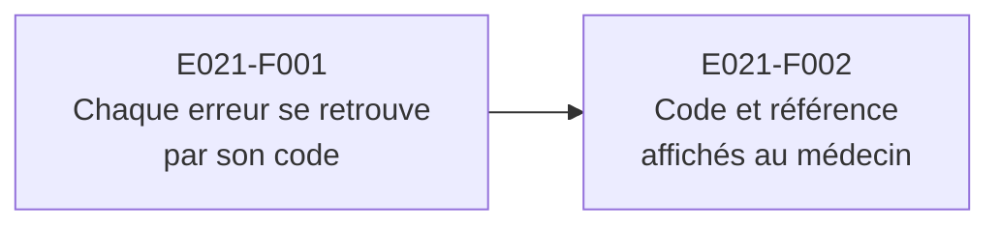

# E021 — Analyse des pannes en production

> **Statut** : 🟡 En cours — 1 fonctionnalité sur 2 livrée, en attente de recette
> **Modèle** : task-driven
> **Version** : 1.1
> **Auteur** : PO forge
> **Audience** : PO, direction, support, équipe produit — la vue ingénierie vit dans [E021-Changelogs.md](E021-Changelogs.md)
> **Dernière mise à jour** : 2026-11-02

---

<!-- toc:start — section générée par /tech-writer ; ne pas éditer manuellement -->

## Sommaire

- [1. Vision](#1-vision)
- [2. Objectifs métier](#2-objectifs-métier)
- [3. Acteurs concernés](#3-acteurs-concernés)
- [4. Features de l'EPIC](#4-features-de-lepic)
- [5. Workflow entre Features](#5-workflow-entre-features)
- [6. Règles métier transverses](#6-règles-métier-transverses)
- [7. Contraintes et hypothèses](#7-contraintes-et-hypothèses)
- [8. Critères d'acceptation de l'EPIC](#8-critères-dacceptation-de-lepic)
- [9. Hors périmètre](#9-hors-périmètre)
- [État de couverture (2026-11-02)](#état-de-couverture-2026-11-02)
- [Synthèse fonctionnelle des changelogs](#synthèse-fonctionnelle-des-changelogs)

<!-- toc:end -->

---

## 1. Vision

Quand la messagerie refuse une action ou tombe en panne, le médecin appelle le support. Jusqu'ici,
le support cherchait l'incident à partir d'une description : une phrase, une heure approximative.
Cet EPIC donne à chaque erreur **un code stable et une référence**. Le médecin peut les transmettre,
et le support retrouve l'incident exact, sa cause probable et la première action à mener.

Cette exploitabilité ne se paie pas en lenteur. Rien ne s'ajoute au traitement d'une demande qui
réussit : l'effort ne porte que sur les erreurs.

---

## 2. Objectifs métier

- Retrouver une erreur vue en production **par son code**, sans recherche au texte libre.
- Donner au support, pour chaque code, une **fiche** : cause probable, impact pour le médecin,
  première action.
- Permettre au médecin de transmettre une **référence précise** au support.
- Repérer qu'une erreur devient plus fréquente après une mise en production.
- **Ne dégrader en rien** le temps de réponse de la messagerie.

---

## 3. Acteurs concernés

- **Le médecin et son secrétariat**, qui voient le message d'erreur et appellent le support.
- **Le support**, qui relie l'appel à l'incident exact.
- **L'exploitation**, qui surveille la fréquence des erreurs et leur évolution d'une version à l'autre.

---

## 4. Features de l'EPIC

| Fonctionnalité | Ce que le praticien et le support peuvent faire | Tasks | Statut |
|---|---|---|---|
| E021-F001 — Chaque erreur se retrouve par son code | Le support retrouve une erreur par son code, avec sa famille, la version en service et, pour une session de carte refusée, la cause donnée par le service d'authentification. Une fiche par code dit quoi en penser et quoi faire. | task-420 | 🟢 Livrée, en attente de recette |
| E021-F002 — Un code et une référence affichés au médecin | Sous le message d'erreur, le médecin lit « Code : … — Réf. : … » et peut les copier pour le support, sur l'application web, le mobile et Blazor. | task-421 | ⚪ À faire |

> Le bilan d'avancement par feature (statut, couverture, tasks contributives) est consigné en fin de
> document, dans la section *État de couverture*.

---

## 5. Workflow entre Features

La seconde fonctionnalité affiche ce que la première garantit : un code présent sur chaque erreur,
y compris une panne imprévue (task-420).

---

## 6. Règles métier transverses

| Règle | Énoncé | Statut |
|---|---|---|
| Aucune donnée de santé | Le code, la référence et les informations jointes à une erreur ne contiennent jamais de donnée de santé ni d'identité : ni INS, ni contenu de message, ni adresse, ni RPPS. | ✅ Implémenté côté serveur (task-420) |
| Codes stables | Un code déjà publié n'est jamais renommé : les trois applications s'y réfèrent pour expliquer un refus au médecin. | ✅ Implémenté (task-420) |
| Aucun coût sur les demandes réussies | Le suivi des erreurs ne s'exécute qu'en cas d'erreur. Une mesure comparative en charge le vérifie avant livraison. | ✅ Mesuré (task-420) |

---

## 7. Contraintes et hypothèses

### Contraintes

- Les journaux de la messagerie ne s'affichent plus dans la console du serveur (décision du 2026-11-01).
  Ils partent vers les outils de supervision, et chaque environnement doit en configurer au moins un.
- Les messages d'erreur montrés aux praticiens ne changent pas : le code et la référence s'y ajoutent.

### Hypothèses

- Le support dispose d'un accès aux journaux de supervision pour rechercher une référence.

---

## 8. Critères d'acceptation de l'EPIC

- [ ] Toutes les Features sont implémentées et validées.
- [ ] Une erreur provoquée en recette se retrouve dans les journaux par son code.
- [ ] Le médecin peut copier un code et une référence, que le support retrouve.
- [ ] La mesure comparative en charge ne montre aucune dégradation des demandes réussies.

---

## 9. Hors périmètre

- Les alertes et tableaux de bord bâtis sur la fréquence des erreurs : ils se configurent dans l'outil
  de supervision.
- Les erreurs des autres services (authentification par carte, logiciel métier) affichées telles
  quelles : leur forme n'est pas garantie.
- Une page de recherche par référence pour le support : la recherche se fait dans l'outil de supervision.

---

## État de couverture (2026-11-02)

| Feature | Statut | Couverture | Tasks contributives |
|---|---|---|---|
| E021-F001 — Chaque erreur se retrouve par son code | 🟢 Livrée, en attente de recette | 100 % | task-420 |
| E021-F002 — Un code et une référence affichés au médecin | ⚪ À faire | 0 % | task-421 |

**Couverture EPIC consolidée : 50 %** (1 fonctionnalité sur 2, en attente de recette).

---

## Synthèse fonctionnelle des changelogs

### Fonctionnalités métier

- v1.1 — Le support retrouve chaque erreur par un code stable, et une fiche par code donne la cause probable,
  l'impact pour le médecin et la première action. Une panne imprévue porte elle aussi un code (task-420).

### Conformité réglementaire

- v1.1 — Aucune donnée de santé ni d'identité dans les informations jointes aux erreurs (task-420).

### Sécurité

- v1.1 — La cause donnée par le service d'authentification par carte est conservée pour le support, filtrée,
  et jamais montrée à l'écran (task-420).

### Technique / observabilité

- v1.1 — Fréquence des erreurs par code suivie en continu ; journaux retirés de la console du serveur.
  Aucune dégradation mesurée du temps de réponse (task-420).

---

*Document généré et maintenu par la forge (/tech-writer) à partir des task files de l'EPIC E021.*
