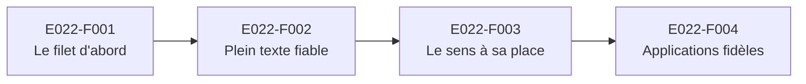

# E022 — Recherche fiable

> **Statut** : 🟡 En cours (3 features sur 3 livrées, la dernière en attente de validation humaine ; la 4ᵉ reprise par l'EPIC E023)
> **Version** : 0.3
> **Auteur** : PO forge (tasks 438 à 440)
> **Modèle** : task-driven
> **Dernière mise à jour** : 2026-11-10
> **Vue ingénierie** : [E022-Changelogs.md](E022-Changelogs.md)

---

<!-- toc:start — section générée par /tech-writer ; ne pas éditer manuellement -->

## Sommaire

- [1. Vision](#1-vision)
- [2. Objectifs métier](#2-objectifs-métier)
- [3. Acteurs concernés](#3-acteurs-concernés)
- [4. Features de l'EPIC](#4-features-de-lepic)
- [5. Workflow entre Features](#5-workflow-entre-features)
- [6. Règles métier transverses](#6-règles-métier-transverses)
- [7. Contraintes et hypothèses](#7-contraintes-et-hypothèses)
- [8. Critères d'acceptation de l'EPIC](#8-critères-dacceptation-de-lepic)
- [9. Hors périmètre](#9-hors-périmètre)
- [Synthèse fonctionnelle des changelogs](#synthèse-fonctionnelle-des-changelogs)

<!-- toc:end -->

---

## 1. Vision

Quand le praticien cherche un message, il doit trouver **tous** les messages de sa boîte qui contiennent ce qu'il a
tapé, quelle que soit sa façon de l'écrire, et sur tout l'historique, y compris les comptes rendus anciens d'un patient
suivi depuis des années. Les messages qui contiennent tous ses mots arrivent en premier. Les messages simplement
« proches » par le sens arrivent ensuite, à part, et sans jamais noyer les bons résultats. La recherche se comporte de la
même façon dans weda2 et sur le mobile.

Une campagne menée le 2026-11-09 sur une boîte réelle de plus de 11 000 messages a montré l'inverse :
- un accent oublié faisait disparaître presque tous les résultats ;
- un mot présent seulement dans l'objet n'était pas trouvé ;
- l'historique ancien d'un patient devenait introuvable dès que son nom était fréquent ;
- un mot absent ramenait des dizaines de résultats sur le mobile.

Aucun test ne l'avait vu. L'EPIC commence donc par le **filet** qui juge la recherche comme un médecin la juge, avant
de corriger.

---

## 2. Objectifs métier

- [x] Disposer d'un filet qui juge la recherche sur le **contenu** de ses résultats, tapée comme un médecin, dans le mode
      réel des deux applications (task-438)
- [ ] Rendre la recherche insensible aux accents, à la casse et à la ponctuation, sur l'objet, le corps, les documents
      médicaux, l'expéditeur et le nom des pièces jointes, sur tout l'historique de la boîte
- [ ] Faire passer les correspondances exactes avant les résultats proches par le sens, avec un seuil unique fixé par le
      serveur
- [ ] Afficher dans weda2 et sur le mobile exactement ce que le serveur a trouvé, dans son ordre, jusqu'au dernier résultat

---

## 3. Acteurs concernés

| Acteur | Rôle dans l'EPIC |
|--------|------------------|
| Médecin généraliste | Cherche un message, un compte rendu ou l'historique d'un patient dans sa boîte |
| Secrétaire médicale, délégataire | Cherche pour le compte du titulaire, dans la même boîte et avec la même recherche |
| Équipe produit | Suit la qualité de la recherche grâce aux requêtes de référence |

---

## 4. Features de l'EPIC

| # | Fonctionnalité | Ce que le praticien peut faire | Tasks | Statut |
|---|---|---|---|---|
| E022-F001 | Le filet d'abord | Rien de visible : la qualité de la recherche est désormais mesurée en continu sur des requêtes tapées comme un médecin (sans accent, en majuscules, avec un nom de patient), et chaque défaut connu attend sa correction | task-438 | ✅ Livré |
| E022-F002 | Recherche plein texte fiable | Trouver un message qu'il ait mis les accents ou non, par un mot de l'objet, de l'expéditeur ou du nom d'une pièce jointe, et retrouver tout l'historique d'un patient ; voir en premier les messages qui contiennent tous ses mots | task-439 | ✅ Livré |
| E022-F003 | Recherche par le sens à sa place | Voir les résultats exacts d'abord, puis, à part, les messages proches par le sens ; ne plus voir de résultats sans rapport quand le mot cherché n'existe pas | task-440 | ✅ Livré, en attente de validation humaine |
| E022-F004 | Applications fidèles au serveur | Voir dans weda2 et sur le mobile les mêmes résultats, dans le même ordre, en trois parties titrées, avec « Voir plus » jusqu'au dernier résultat et un avertissement si une partie de la recherche est indisponible | task-441 (retirée) | ↪ Reprise par l'EPIC E023 : task-445 pour weda2, task-450 pour le mobile |

---

## 5. Workflow entre Features

**Description du workflow** :

1. **E022-F001** pose les requêtes de référence et les parcours qui affirment le contenu des résultats. Chaque défaut
   relevé par la campagne y est noté avec la feature qui doit le corriger (task-438).
2. **E022-F002** corrige la recherche par les mots. Elle s'appuie sur le filet : un défaut est corrigé quand sa
   requête de référence passe au vert.
3. **E022-F003** remet la recherche par le sens à sa place, derrière les correspondances exactes. Elle dépend de
   E022-F002, qui a défini les groupes « tous les mots » et « une partie des mots ».
4. **E022-F004** aligne l'affichage des deux applications sur ce que le serveur rend. Elle vient en dernier, car elle
   affiche les groupes et les sections définis par les deux features précédentes. Elle est désormais portée par l'EPIC
   E023 « Expérience de recherche » (task-445 pour weda2, task-450 pour le mobile).

---

## 6. Règles métier transverses

| ID | Règle | Description | Statut |
|----|-------|-------------|--------|
| RG-E022-01 | Tapée comme un médecin | La recherche trouve le même message que le praticien mette les accents ou non, en majuscules ou en minuscules, avec ou sans ponctuation | ✅ Corrigée (task-439), vérifiée par les requêtes de référence |
| RG-E022-02 | Tous les mots d'abord | Les messages qui contiennent tous les mots cherchés passent devant ceux qui n'en contiennent qu'une partie | ✅ Corrigée (task-439), vérifiée par les requêtes de référence |
| RG-E022-03 | Tout l'historique | Aucun message n'est écarté parce qu'il est ancien | ✅ Corrigée (task-439), vérifiée par les requêtes de référence |
| RG-E022-04 | Exacts d'abord, proches ensuite | Les résultats trouvés par le sens forment une partie à part, après les correspondances exactes, selon un seuil unique fixé par le serveur | ✅ Corrigée (task-440) : seuil 0,45 calibré sur le corpus de référence |
| RG-E022-05 | Le dossier courant | Une recherche dans un dossier ne rend que des messages de ce dossier | ✅ Vérifiée en continu (task-438) |
| RG-E022-06 | Même boîte, même trace | La recherche respecte la boîte partagée : même base pour toutes les personnes de la boîte, accès ouvert par l'opérateur, chaque recherche tracée au nom de la personne qui l'a faite (règle 14 de la plateforme) | ✅ Inchangée |

---

## 7. Contraintes et hypothèses

### Contraintes
- Aucune donnée de santé réelle dans les requêtes de référence : la boîte de référence est entièrement fictive.
- Les termes cherchés par le praticien n'apparaissent jamais en clair dans les journaux techniques.
- La recherche ne doit pas ralentir avec la taille de la boîte. Une boîte cible compte environ 10 000 messages, et le
  coût de la recherche y est mesuré.

### Hypothèses
- Les deux applications envoient la même requête au serveur. Toute différence de comportement vient de leur affichage,
  ce que corrige E022-F004.

---

## 8. Critères d'acceptation de l'EPIC

- [ ] Toutes les Features sont implémentées et validées.
- [ ] Toutes les requêtes de référence sont vertes sur les deux profils (weda2 et mobile), sans aucune marque de défaut
      connu.
- [ ] Les parcours de recherche passent dans les deux applications et affirment le contenu des résultats.
- [ ] La campagne rejouée sur une boîte réelle de formation ne montre plus aucun des défauts du 2026-11-09.

---

## 9. Hors périmètre

- La recherche de patients et la recherche avancée par filtres : inchangées.
- L'index de la recherche par le sens (vitesse sur les grandes boîtes) : traité à part (task-437).

---

## Synthèse fonctionnelle des changelogs

### Ce qui change pour le praticien

- **v0.3 — La recherche par le sens à sa place.** Les messages qui contiennent les mots cherchés viennent toujours
  en premier ; les messages proches par le sens forment une partie à part, après eux, et n'y entrent que s'ils sont
  réellement proches. Le seuil est le même dans weda2 et sur le mobile, pour tout le monde : la même recherche rend
  désormais la même réponse dans les deux applications. Un mot absent de la boîte ne ramène plus des dizaines de
  messages sans rapport. Une formulation différente peut encore trouver des messages par le sens : « hypercholestérolémie »
  retrouve les bilans lipidiques, « anémie » une hémoglobine basse (task-440).
- **v0.2 — Recherche plein texte fiable.** Le praticien retrouve un message qu'il ait mis les accents ou non, en
  majuscules ou en minuscules, avec ou sans ponctuation. Un mot de l'objet, du nom ou de l'adresse de l'expéditeur, ou
  du nom d'une pièce jointe suffit. Tout l'historique d'un patient est retrouvé, page par page, les messages les plus
  anciens compris. Les messages qui contiennent tous les mots cherchés viennent en premier, puis ceux qui n'en
  contiennent qu'une partie, puis les messages proches par le sens. Sur une boîte de formation de 11 178 messages,
  « hemoglobine » trouve 805 messages au lieu de 2, et « urgent » 72 au lieu de 5. À forte charge, la recherche répond
  un peu plus vite qu'avant (task-439).

### Technique / qualité (sans impact utilisateur direct)

- **v0.1 — Le filet d'abord.** La recherche est désormais jugée sur des requêtes tapées comme un médecin, dans le mode
  réel des deux applications, sur une boîte de référence fictive de 560 messages. Les défauts relevés par la campagne
  du 2026-11-09 y sont mesurés et attendent leur correction. Deux nouveaux parcours, dans weda2 et sur le mobile,
  vérifient qu'un mot rare et accentué, puis un numéro de dossier, retrouvent leur message, et lui seul (task-438).

---

*Document vivant maintenu par `/tech-writer`. Les sections 1 à 3, 7 et 9 peuvent être enrichies à la main ; elles sont
préservées.*
