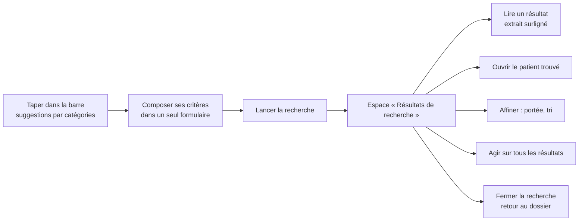

# E023 — Expérience de recherche

> **Statut** : 🟡 En cours (1 feature sur 9 livrée, en attente de validation humaine)
> **Version** : 0.1
> **Auteur** : PO forge (tasks 442 à 449, 452)
> **Modèle** : task-driven
> **Dernière mise à jour** : 2026-11-11
> **Vue ingénierie** : [E023-Changelogs.md](E023-Changelogs.md)

---

<!-- toc:start — section générée par /tech-writer ; ne pas éditer manuellement -->

## Sommaire

- [1. Vision](#1-vision)
- [2. Objectifs métier](#2-objectifs-métier)
- [3. Acteurs concernés](#3-acteurs-concernés)
- [4. Features de l'EPIC](#4-features-de-lepic)
- [5. Workflow entre Features](#5-workflow-entre-features)
- [6. Règles métier transverses](#6-règles-métier-transverses)
- [7. Contraintes et hypothèses](#7-contraintes-et-hypothèses)
- [8. Critères d'acceptation de l'EPIC](#8-critères-dacceptation-de-lepic)
- [9. Hors périmètre](#9-hors-périmètre)
- [État de couverture (2026-11-11)](#état-de-couverture-2026-11-11)
- [Synthèse fonctionnelle des changelogs](#synthèse-fonctionnelle-des-changelogs)

<!-- toc:end -->

---

## 1. Vision

Le praticien compose sa recherche comme il le ferait dans une messagerie de bureau moderne. Il remplit un seul
formulaire, avec ses critères de médecin, puis il lance la recherche. Il arrive alors dans un espace « Résultats de
recherche », distinct de son dossier, qu'il affine sur place et dont il sort quand il le décide. Chaque résultat dit
pourquoi il est là, et les patients que la recherche désigne sont proposés en tête.

L'EPIC E022 a rendu la recherche **juste**. E023 la rend **agréable et lisible**, en partant de weda2 ; le mobile suit
le même modèle. Le modèle retenu le 2026-11-10 avec l'humain s'inspire de la recherche d'une grande messagerie de bureau.

---

## 2. Objectifs métier

- [x] Composer ses critères dans un seul formulaire, puis lancer la recherche quand on le décide (task-442)
- [ ] Chercher avec les critères du métier : patient, type de document, biologie, expéditeur
- [ ] Voir les résultats dans un espace dédié, fidèle à ce que le serveur a trouvé, et en sortir explicitement
- [ ] Comprendre pourquoi chaque résultat est là, et retrouver d'un geste le patient concerné
- [ ] Chercher dans toute la boîte par défaut, choisir l'ordre, et agir sur tous les résultats d'un coup
- [ ] Être guidé pendant la frappe par ce que la boîte contient
- [ ] Mesurer la qualité vécue de la recherche, sans jamais savoir ce qui a été cherché ni par qui

---

## 3. Acteurs concernés

- **Le médecin** et, plus largement, toute personne rattachée à une boîte MSSanté (titulaire, délégataire, membre) qui
  cherche un message, un document ou un patient.
- **L'équipe produit**, qui suit la qualité de la recherche sur un tableau de bord anonyme.

---

## 4. Features de l'EPIC

| Fonctionnalité | Ce que le praticien peut faire | Tasks | Statut |
|---|---|---|---|
| Formulaire à un seul niveau | Composer tous ses critères au même endroit, puis lancer la recherche ; rien ne part avant | task-442 | 🟢 Livrée, en attente de validation |
| Critères médicaux | Restreindre la recherche à un patient choisi dans sa boîte, à un type de document, à la biologie | task-443 | 🔴 À faire |
| Réponse enrichie | Savoir où le terme a été trouvé, en voir un extrait, connaître les patients désignés | task-444 | 🔴 À faire |
| Mode « Résultats de recherche » | Voir les résultats dans un espace dédié, les affiner sur place, en sortir explicitement | task-445 | 🔴 À faire |
| Lire un résultat | Voir l'extrait surligné de chaque résultat et ouvrir le patient trouvé en tête | task-446 | 🔴 À faire |
| Portée et tri | Chercher dans toute la boîte ou dans le dossier courant, et choisir l'ordre des résultats | task-447 | 🔴 À faire |
| Actions groupées | Sélectionner tous les résultats, même ceux pas encore affichés, et leur appliquer une action | task-448 | 🔴 À faire |
| Suggestions pendant la frappe | Recevoir des propositions par catégories (patients, messages) dès les premières lettres | task-449 | 🔴 À faire |
| Mesure anonyme de l'expérience | (équipe produit) Suivre le taux de recherches sans résultat et la qualité vécue | task-452 | 🔴 À faire |

> Le bilan d'avancement par feature (statut, couverture, tasks contributives) est consigné en fin de document, dans la
> section *État de couverture*.

---

## 5. Workflow entre Features

Ce que fait le praticien, du début à la fin d'une recherche :

Le formulaire (task-442) est la porte d'entrée : on y compose, on lance, il se ferme pour laisser voir les résultats.

---

## 6. Règles métier transverses

- **Rien ne part avant le geste du praticien.** Cocher un critère ne lance pas de recherche ; seul « Lancer la
  recherche » (ou Entrée) la lance (task-442).
- **Fermer sans lancer ne change rien.** Les critères modifiés et non lancés sont abandonnés ; la recherche affichée
  reste la même, et rouvrir le formulaire montre ses critères (task-442).
- **Un patient se choisit, il ne se tape pas.** Le critère patient est une sélection parmi les patients de la boîte.
- **Chaque recherche lancée est tracée au nom de la personne qui l'a faite**, comme tout acte sur la boîte. Cocher un
  critère sans lancer n'est pas un acte.
- **La mesure de l'expérience est anonyme** : elle ne conserve ni le texte cherché ni l'identité de qui cherche.

---

## 7. Contraintes et hypothèses

- weda2 d'abord ; le mobile adopte le même modèle par une refonte dédiée.
- Les deux applications restent décrites par les mêmes parcours vérifiés ; un écart temporaire est déclaré et daté.
- Les boutons et contrôles du formulaire sont ceux du design system de weda2.

---

## 8. Critères d'acceptation de l'EPIC

- [ ] Toutes les features sont livrées et validées par l'humain
- [ ] Le praticien compose, lance, lit, affine et quitte une recherche sans jamais perdre la liste de son dossier
- [ ] Le mobile offre la même expérience

---

## 9. Hors périmètre

- La justesse de la recherche elle-même (accents, champs, seuil, ordre) : EPIC E022.
- La refonte mobile de la recherche est suivie à part (task-450) ; d'ici là, le mobile garde son formulaire actuel.

---

## État de couverture (2026-11-11)

| Feature | Statut | Couverture | Tasks contributives |
|---|---|---|---|
| Formulaire à un seul niveau | 🟢 Livrée, en attente de validation | 100 % | task-442 |
| Critères médicaux | 🔴 À faire | 0 % | task-443 |
| Réponse enrichie | 🔴 À faire | 0 % | task-444 |
| Mode « Résultats de recherche » | 🔴 À faire | 0 % | task-445 |
| Lire un résultat | 🔴 À faire | 0 % | task-446 |
| Portée et tri | 🔴 À faire | 0 % | task-447 |
| Actions groupées | 🔴 À faire | 0 % | task-448 |
| Suggestions pendant la frappe | 🔴 À faire | 0 % | task-449 |
| Mesure anonyme de l'expérience | 🔴 À faire | 0 % | task-452 |

**Couverture EPIC consolidée : 11 %** (1 feature livrée sur 9, en attente de validation humaine).

---

## Synthèse fonctionnelle des changelogs

**Fonctionnalités métier**
- v0.1 — Dans weda2, le formulaire de recherche n'a plus qu'un niveau. Le praticien compose ses critères puis clique
  « Lancer la recherche » ; « Réinitialiser les paramètres » vide le formulaire sans perdre les résultats affichés
  (task-442).

**Conformité réglementaire**
- Aucun changement : chaque recherche lancée reste tracée au nom de son auteur.

**Sécurité**
- Aucun changement.

**Technique / observabilité** (sans impact utilisateur direct)
- Le parcours « composer puis lancer » est vérifié automatiquement à chaque cycle dans weda2.

---

*Document maintenu par /tech-writer — vue produit. Le détail technique vit dans [E023-Changelogs.md](E023-Changelogs.md).*
