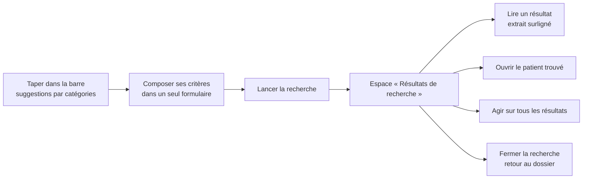

# E023 — Expérience de recherche

> **Statut** : 🟡 En cours (5 features sur 7 livrées)
> **Version** : 0.5
> **Auteur** : PO forge (tasks 442 à 446, 448, 449)
> **Modèle** : task-driven
> **Dernière mise à jour** : 2026-11-11
> **Vue ingénierie** : [E023-Changelogs.md](E023-Changelogs.md)

---

<!-- toc:start — section générée par /tech-writer ; ne pas éditer manuellement -->

## Sommaire

- [1. Vision](#1-vision)
- [2. Objectifs métier](#2-objectifs-métier)
- [3. Acteurs concernés](#3-acteurs-concernés)
- [4. Features de l'EPIC](#4-features-de-lepic)
- [5. Workflow entre Features](#5-workflow-entre-features)
- [6. Règles métier transverses](#6-règles-métier-transverses)
- [7. Contraintes et hypothèses](#7-contraintes-et-hypothèses)
- [8. Critères d'acceptation de l'EPIC](#8-critères-dacceptation-de-lepic)
- [9. Hors périmètre](#9-hors-périmètre)
- [État de couverture (2026-11-11)](#état-de-couverture-2026-11-11)
- [Synthèse fonctionnelle des changelogs](#synthèse-fonctionnelle-des-changelogs)

<!-- toc:end -->

---

## 1. Vision

Le praticien compose sa recherche comme il le ferait dans une messagerie de bureau moderne. Il remplit un seul
formulaire, avec ses critères de médecin, puis il lance la recherche. Il arrive alors dans un espace « Résultats de
recherche », distinct de son dossier, qu'il affine sur place et dont il sort quand il le décide. Chaque résultat dit
pourquoi il est là, et les patients que la recherche désigne sont proposés en tête.

L'EPIC E022 a rendu la recherche **juste**. E023 la rend **agréable et lisible**, en partant de weda2 ; le mobile suit
le même modèle. Le modèle retenu le 2026-11-10 avec l'humain s'inspire de la recherche d'une grande messagerie de bureau.

---

## 2. Objectifs métier

- [x] Composer ses critères dans un seul formulaire, puis lancer la recherche quand on le décide (task-442)
- [x] Chercher avec les critères du métier : patient, date du document, biologie anormale, expéditeurs, pièce jointe (task-443)
- [ ] Voir les résultats dans un espace dédié, fidèle à ce que le serveur a trouvé, et en sortir explicitement
- [ ] Comprendre pourquoi chaque résultat est là, et retrouver d'un geste le patient concerné (serveur prêt : task-444 ; affichage : task-446)
- [ ] Agir sur tous les résultats d'un coup
- [ ] Être guidé pendant la frappe par ce que la boîte contient

---

## 3. Acteurs concernés

- **Le médecin** et, plus largement, toute personne rattachée à une boîte MSSanté (titulaire, délégataire, membre) qui
  cherche un message, un document ou un patient.

---

## 4. Features de l'EPIC

| Fonctionnalité | Ce que le praticien peut faire | Tasks | Statut |
|---|---|---|---|
| Formulaire à un seul niveau | Composer tous ses critères au même endroit, puis lancer la recherche ; rien ne part avant ; « De » se choisit parmi ses contacts | task-442 | ✅ Livrée |
| Critères médicaux | Restreindre la recherche à un patient choisi dans la liste, à la date du document médical, à la biologie marquée anormale par le laboratoire, à un ou plusieurs expéditeurs, au nom d'une pièce jointe | task-443 | ✅ Livrée |
| Réponse enrichie | Savoir où le terme a été trouvé, en voir un extrait, connaître les patients désignés | task-444 | ✅ Livrée côté serveur |
| Mode « Résultats de recherche » | Voir les résultats dans un espace dédié, les affiner sur place, en sortir explicitement | task-445 | ✅ Livrée dans weda2 |
| Lire un résultat | Voir l'extrait surligné de chaque résultat et ouvrir le patient trouvé en tête | task-446 | ✅ Livrée dans weda2 |
| Actions groupées | Sélectionner tous les résultats, même ceux pas encore affichés, et leur appliquer une action | task-448 | ✅ Livrée |
| Suggestions pendant la frappe | Recevoir des propositions par catégories (patients, messages) dès les premières lettres | task-449 | 🟡 En revue (PRs ouvertes) |

> Le bilan d'avancement par feature (statut, couverture, tasks contributives) est consigné en fin de document, dans la
> section *État de couverture*.

---

## 5. Workflow entre Features

Ce que fait le praticien, du début à la fin d'une recherche :

Le formulaire (task-442) est la porte d'entrée : on y compose, on lance, il se ferme pour laisser voir les résultats.
L'espace « Résultats de recherche » (task-445) remplace la liste du dossier sans la perdre : « Fermer la recherche »
la rend telle quelle, à la même position.

---

## 6. Règles métier transverses

- **La recherche porte sur le dossier sélectionné, et sur lui seul** (décision de l'humain du 2026-11-11). Aucune
  recherche dans plusieurs dossiers ni dans toute la boîte.
- **Rien ne part avant le geste du praticien.** Cocher un critère ne lance pas de recherche ; seul « Lancer la
  recherche » (ou Entrée) la lance (task-442).
- **Fermer sans lancer ne change rien.** Les critères modifiés et non lancés sont abandonnés ; la recherche affichée
  reste la même, et rouvrir le formulaire montre ses critères (task-442).
- **Un patient se choisit, il ne se tape pas.** Le critère patient est une sélection parmi les patients de la boîte ;
  un nom tapé sans choix n'est jamais envoyé. Le patient est montré par ses traits d'identification (nom, prénom, date
  de naissance), jamais par son INS (task-443).
- **La biologie anormale est celle que le laboratoire a marquée.** Une valeur hors des bornes sans indicateur du
  laboratoire n'est pas « anormale » : la plateforme ne juge pas à la place du biologiste (task-443).
- **Un critère vaut pour toute la réponse.** Un message proche par le sens qui ne respecte pas un critère n'est pas
  rendu (task-443).
- **Les critères se combinent.** Ils s'ajoutent les uns aux autres ; plusieurs expéditeurs choisis s'additionnent. Un
  critère seul, sans texte, est une recherche valide (task-443).
- **Un patient trouvé l'est par correspondance exacte.** Nom et prénom, nom et date de naissance complète, ou INS
  complète. Jamais de rapprochement approché, phonétique ou par le sens : un nom voisin ne désigne personne (task-444).
- **L'INS ne sort jamais d'une recherche.** Elle peut être cherchée, mais elle n'est ni affichée, ni journalisée, ni
  gardée dans l'historique, ni envoyée au moteur d'IA ; seul son statut (qualifiée ou non) est montré (task-444).
- **Les résultats sont ceux du serveur, dans son ordre.** Aucun tri ni filtre local ; un filtre d'affinage devient un
  critère de la recherche, relancée aussitôt. Les résultats se rangent en trois parties : « Tous les mots », « Une
  partie des mots », « Résultats proches » (task-445).
- **Une recherche ne cache jamais une panne.** Si une partie du moteur ne répond pas, un bandeau le dit ; si la
  recherche échoue, un message le dit et aucune ancienne liste ne reste affichée (task-445).
- **Sortir d'une recherche rend le dossier tel qu'il était** : son filtre, sa page et sa position ; changer de dossier
  ferme la recherche (task-445).
- **Un résultat dit pourquoi il est là** : son dossier, l'endroit où le mot a été trouvé, et un extrait où le mot est
  surligné, même tapé sans accent (task-446).
- **Un patient désigné est proposé, jamais deviné** : seuls les patients que le serveur reconnaît exactement sont
  montrés, par leurs traits d'identification, jamais par leur INS (task-446).
- **Le surlignage ne réinterprète jamais un contenu reçu** : un extrait, un objet ou un corps de message s'affichent
  comme du texte, et un message ouvert pendant une recherche garde sa mise en forme (task-446).
- **Le seuil de similarité n'est plus un réglage personnel** : le serveur applique le même pour tous (task-445).
- **Chaque recherche lancée est tracée au nom de la personne qui l'a faite**, comme tout acte sur la boîte. Cocher un
  critère sans lancer n'est pas un acte.

---

## 7. Contraintes et hypothèses

- weda2 d'abord ; le mobile adopte le même modèle par une refonte dédiée.
- Les deux applications restent décrites par les mêmes parcours vérifiés ; un écart temporaire est déclaré et daté.
- Les boutons et contrôles du formulaire sont ceux du design system de weda2.

---

## 8. Critères d'acceptation de l'EPIC

- [ ] Toutes les features sont livrées et validées par l'humain
- [ ] Le praticien compose, lance, lit, affine et quitte une recherche sans jamais perdre la liste de son dossier
- [ ] Le mobile offre la même expérience

---

## 9. Hors périmètre

- La recherche dans plusieurs dossiers ou dans toute la boîte : écartée par l'humain le 2026-11-11.
- La mesure anonyme de l'expérience de recherche (tableau de bord de l'équipe produit) : reportée par l'humain le
  2026-11-11 (task-452 supprimée pour le moment).
- Un tri des résultats « Les plus récents » : écarté par l'humain le 2026-11-11 (task-447 supprimée). Le serveur classe
  déjà chaque groupe de résultats exacts du plus récent au plus ancien ; un tri par date n'aurait changé l'ordre que pour
  une recherche à plusieurs mots, en faisant passer un message partiel devant celui qui contient tous les mots.
- La justesse de la recherche elle-même (accents, champs, seuil, ordre) : EPIC E022.
- La refonte mobile de la recherche est suivie à part (task-450) ; d'ici là, le mobile garde son formulaire actuel.

---

## État de couverture (2026-11-12)

| Feature | Statut | Couverture | Tasks contributives |
|---|---|---|---|
| Formulaire à un seul niveau | ✅ Livrée | 100 % | task-442 |
| Critères médicaux | ✅ Livrée | 100 % | task-443 |
| Réponse enrichie | ✅ Livrée côté serveur | 100 % | task-444 |
| Mode « Résultats de recherche » | ✅ Livrée dans weda2 | 100 % | task-445 |
| Lire un résultat | ✅ Livrée dans weda2 | 100 % | task-446 |
| Actions groupées | ✅ Livrée | 100 % | task-448 |
| Suggestions pendant la frappe | 🟡 En revue (PRs ouvertes) | 90 % | task-449 |

**Couverture EPIC consolidée : 99 %** (6 features livrées sur 7, la 7e en revue : PRs api-mail #367 et dtos-mss #65 ;
weda2 à pousser sur TFS).

---

## Synthèse fonctionnelle des changelogs

**Fonctionnalités métier**
- v0.1 — Dans weda2, le formulaire de recherche n'a plus qu'un niveau. Le praticien compose ses critères puis clique
  « Lancer la recherche » ; « Réinitialiser les paramètres » vide le formulaire sans perdre les résultats affichés
  (task-442).
- v0.1 — Le formulaire reprend le dessin de la maquette : fenêtre plus large, critères sur deux colonnes, et « De » se
  choisit parmi les contacts, comme à la rédaction d'un message (task-442).
- v0.2 — Le praticien restreint sa recherche avec les critères de son métier : un patient choisi dans la liste, la date
  du document médical, la biologie marquée anormale par le laboratoire, un ou plusieurs expéditeurs de sa boîte, le nom
  d'une pièce jointe. Les critères sont rejoués par l'historique des recherches (task-443).
- v0.3 — Le serveur dit pourquoi chaque message est trouvé (où, avec un extrait et les mots à surligner, même tapés
  sans accent) et quels patients de la boîte la recherche désigne. weda2 et le mobile l'afficheront (task-446,
  task-451) (task-444).
- v0.4 — Dans weda2, lancer une recherche ouvre l'espace « Résultats de recherche » : « Résultats : N messages », une
  étiquette par critère (une croix la retire et relance), des filtres pour affiner sur place, trois parties (« Tous
  les mots », « Une partie des mots », « Résultats proches »), « Voir plus » jusqu'au dernier résultat, un bandeau
  quand le moteur est en panne partielle, un message clair en cas d'échec. « Fermer la recherche » rend le dossier à
  la même position. Le réglage « Sensibilité de la recherche » disparaît des Paramètres (task-445).
- v0.5 — Chaque résultat montre son dossier, l'endroit où le mot a été trouvé et un extrait où il est surligné. Une
  rangée « Patients » propose en tête les patients que la recherche désigne ; un clic ouvre leurs messages. Le message
  ouvert depuis les résultats montre les mots cherchés surlignés dans son objet et son corps (task-446).
- v0.6 — « Tout sélectionner » dans les résultats, puis « Sélectionner les N résultats de la recherche », y compris
  ceux qui ne sont pas encore affichés (2 000 au plus, sinon « affinez la recherche »). Marquer lu ou non lu, étoile,
  retirer l'étoile, déplacer, mettre à la Corbeille : une confirmation annonce le nombre de messages, une progression
  suit l'action, et le compte rendu dit ce qui n'a pas été fait (« 340 messages déplacés vers Archives, 2 en échec »),
  avec « Réessayer les échecs ». Un message arrivé après la confirmation n'est pas touché. Ni acquittement ni
  rattachement à un patient en masse (task-448).
- v0.7 — Dès deux lettres tapées, la barre propose par catégories les patients de la boîte, ses correspondants
  (expéditeurs, destinataires), les types de document et les recherches récentes ; au focus, les recherches
  récentes. Choisir un patient ouvre ses messages, un correspondant pose l'étiquette « De » ou « À ». Les préfixes
  `de :`, `à :`, `objet :` restreignent un critère ; `patient :` et `type :` se choisissent dans la liste. Un critère
  tapé cherche chaque mot dans n'importe quel ordre, nom et adresse, sans accents ni casse ; entre guillemets, dans
  l'ordre. Une expression entre guillemets dans la barre est cherchée telle quelle (task-449).

**Conformité réglementaire**
- Chaque recherche lancée reste tracée au nom de son auteur ; la trace ne porte ni le texte cherché, ni l'identité du
  patient filtré, ni les expéditeurs choisis (task-443).
- Identito-vigilance : le patient se choisit par ses traits d'identification, jamais par une saisie libre, et son INS
  n'est jamais affiché (task-443).
- Identito-vigilance : un patient n'est proposé que sur une correspondance exacte ; une INS tapée en recherche n'est
  ni rendue, ni gardée dans l'historique, ni envoyée au fournisseur d'IA (task-444).
- Une action groupée laisse une trace par message, au nom de la personne qui agit, délégataire compris ; remettre un
  message en non lu est désormais tracé lui aussi (task-448).
- Une mise à la Corbeille groupée ne supprime jamais définitivement : depuis la Corbeille, ou depuis un dossier dont le
  type n'est pas connu, elle est refusée et le dit (task-448).
- Une suggestion qui nomme des patients est tracée comme une consultation, au nom de la personne réelle ; une
  liste fermée ne demande rien au serveur, et seul un clic délibéré ouvre un patient. Les recherches récentes sont
  propres à chaque personne, même sur une boîte partagée (task-449).

**Sécurité**
- La liste des expéditeurs de la boîte, comme toute lecture de la boîte, est fermée sans le verdict de l'opérateur
  MSSanté (task-443).
- Deux alertes de sécurité des composants serveur, publiées le 10/11/2026, sont corrigées (task-443).

**Technique / observabilité** (sans impact utilisateur direct)
- Le parcours « composer puis lancer » est vérifié automatiquement à chaque cycle dans weda2.
- Le parcours « restreindre à un patient et à ses biologies anormales » l'est aussi (task-443).
- Cinq parcours de l'espace « Résultats de recherche » sont vérifiés à chaque cycle dans weda2 : nom de patient tapé
  sans accent, « Aucun résultat », « Voir plus », recherche en échec, fermeture à la même position (task-445).
- Le parcours « reconnaître un résultat et ouvrir le dossier du patient » l'est aussi (task-446).
- Le parcours « traiter tous les résultats d'une recherche » l'est aussi (task-448).
- Les parcours « trouver un patient par les premières lettres » et « restreindre à un expéditeur par `de :` »
  le sont aussi (task-449).

---

*Document maintenu par /tech-writer — vue produit. Le détail technique vit dans [E023-Changelogs.md](E023-Changelogs.md).*
