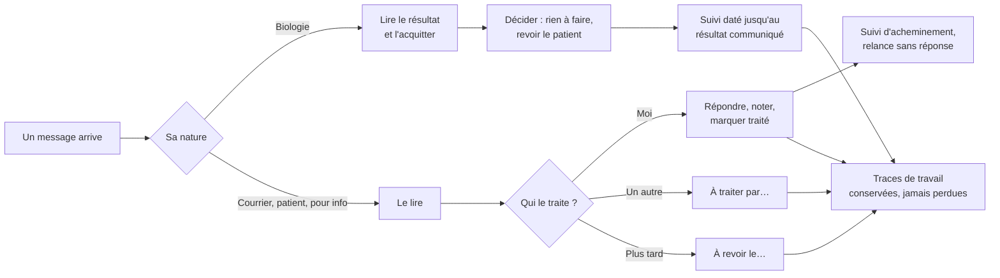

# E024 — Messagerie premium : traiter, déléguer, boucler

> **Statut** : 🟡 en cours — 7 features livrées et validées, 2 livrées en attente de validation (tasks 457, 462),
> 2 au backlog (tasks 458, 488).
> Le 2026-11-12, toutes les features prévues avaient
> été retirées du backlog ; une partie y est revenue le 2026-11-13.
> **Version** : 0.9
> **Auteur** : PO forge (task-453)
> **Modèle** : task-driven
> **Dernière mise à jour** : 2026-11-21
> **Vue ingénierie** : [E024-Changelogs.md](E024-Changelogs.md)

---

<!-- toc:start — section générée par /tech-writer ; ne pas éditer manuellement -->

## Sommaire

- [1. Vision](#1-vision)
- [2. Objectifs métier](#2-objectifs-métier)
- [3. Acteurs concernés](#3-acteurs-concernés)
- [4. Features de l'EPIC](#4-features-de-lepic)
- [5. Workflow entre Features](#5-workflow-entre-features)
- [6. Règles métier transverses](#6-règles-métier-transverses)
- [7. Contraintes et hypothèses](#7-contraintes-et-hypothèses)
- [8. Critères d'acceptation de l'EPIC](#8-critères-dacceptation-de-lepic)
- [9. Hors périmètre](#9-hors-périmètre)
- [État de couverture (2026-11-21)](#état-de-couverture-2026-11-21)
- [Synthèse fonctionnelle des changelogs](#synthèse-fonctionnelle-des-changelogs)

<!-- toc:end -->

---

## 1. Vision

La messagerie ne se contente plus de recevoir et d'envoyer. Elle aide le cabinet à **traiter** ce qui arrive, à
**déléguer** ce qui revient à quelqu'un d'autre, et à **boucler** chaque échange jusqu'au bout : un résultat de
biologie acquitté puis communiqué au patient, un courrier envoyé dont on sait qu'il est arrivé et a été lu, une
demande restée sans réponse qui revient d'elle-même.

Tout ce que le cabinet décide sur un message — acquittement, « traité », report, attribution, note, suivi — est une
trace de travail. Ces traces appartiennent à la boîte, portent le nom de la personne qui les a posées, et ne
disparaissent jamais parce que le message a été rangé ailleurs, depuis la plateforme ou depuis un autre logiciel.

*Source : analyse fonctionnelle des manques de la messagerie du 2026-11-11.*

---

## 2. Objectifs métier

- Le praticien voit ce qui **reste à traiter**, pas seulement ce qui n'est pas lu.
- Le cabinet se **répartit** le travail d'une même boîte sans échange hors de la messagerie.
- Aucun résultat de biologie ne se perd entre sa lecture et sa communication au patient.
- Le praticien sait si son message est **arrivé**, a été **lu**, ou pourquoi il a **échoué**.
- Une trace de travail posée sur un message n'est **jamais perdue**, quoi qu'il arrive au message.

---

## 3. Acteurs concernés

- **Le médecin titulaire** de la boîte.
- **Les confrères membres** d'une boîte organisationnelle.
- **La secrétaire ou l'assistante délégataire**, qui travaille dans la boîte du médecin.
- **Le patient**, destinataire d'un envoi par Mon espace santé.
- **L'équipe produit**, qui suit la charge de la messagerie sans voir aucune donnée de santé.

---

## 4. Features de l'EPIC

> Le bilan d'avancement par feature (statut, couverture, tasks contributives) est consigné en fin de document, dans
> la section *État de couverture*.

| Fonctionnalité | Ce que le praticien peut faire | Tasks | Statut |
|---|---|---|---|
| Un acquittement ne disparaît jamais | Retrouver l'acquittement d'un compte rendu, sa note, son auteur et le patient rattaché à la main, même après que le message a été rangé depuis un autre logiciel, supprimé puis restauré, ou relu après un incident de la messagerie | task-453 | ✅ Livrée et validée |
| Le suivi commence à une date | Choisir, pour toute la boîte, la date à partir de laquelle les messages arrivés réclament un acquittement. Les comptes rendus anciens ramenés par une première synchronisation se consultent et s'acquittent sans rien réclamer, marqués « Antérieur au suivi » | task-466 | ✅ Livrée et validée |
| « Vous avez répondu à ce message le… » | Savoir, en ouvrant un message, qu'on y a déjà répondu, ou qu'un collègue de la boîte l'a fait, quand et combien de fois ; ouvrir la réponse ; repérer d'une icône les messages répondus dans la liste | task-459 | ✅ Livrée et validée |
| Saisie des tags | Poser un tag en quelques touches : la liste propose les tags de la boîte dès qu'on commence à taper, sans tenir compte des majuscules ni des accents ; un nom de plusieurs mots est accepté, jusqu'à 40 caractères ; « Créer le tag » quand aucun tag ne porte ce nom | task-486 | ✅ Livrée et validée |
| Tags système et vues par tag | Retrouver d'un coup d'œil la biologie, les patients, les professionnels de santé et les messages reçus pour information, par des tags posés à l'arrivée | task-456 | ✅ Livrée et validée |
| Marquer un message traité | Voir ce qui reste à traiter, pas seulement ce qui n'est pas lu : un compteur et un filtre « À traiter », un bouton « Traité » (ou un balayage sur mobile), « Annuler » pendant 6 secondes, « Remettre à traiter ». Répondre, ranger ou rattacher un message le traite aussi. Traiter plusieurs messages d'un coup, sans jamais acquitter une biologie. Voir qui a traité et quand | task-454 | ✅ Livrée et validée |
| « À traiter par » | Confier un message à une personne de la boîte : la choisir dans la liste des personnes rattachées et actives, avec leur rôle ; la retrouver sur la ligne (initiales) et dans le détail ; attribuer une sélection d'un coup. La personne le trouve dans sa vue « Pour moi », avec un compteur, et en est avertie ; traiter le message clôt l'attribution | task-457 | 🟢 Livrée — en attente de validation |
| Conversation en chat | Lire un fil comme une conversation : bulles dans l'ordre, les siennes à droite, auteur réel et rôle, pièces jointes, texte cité et signature repliés seulement quand c'est sûr. Voir l'état de chaque envoi (envoyé, distribué, non distribué, lu à l'heure) sans que les accusés encombrent le fil. Répondre en une ligne à tous les participants, avec un fichier joint (et, sur mobile, un document du dossier patient) ; être averti si les destinataires ont changé | task-487 | ✅ Livrée et validée |
| Réponse : ne citer que le message d'origine | Répondre en ne citant que ce que le correspondant vient d'écrire, sans tout l'historique ; la citation est retirée, avec un avertissement, vers un destinataire qui n'était pas dans l'échange ; une case « Inclure le message d'origine » | task-488 | ⏳ À faire |
| Notes internes | Laisser sur un message une note visible des seules personnes de la boîte | task-458 | ⏳ À faire |
| Relance sans réponse | Demander, à l'envoi ou plus tard depuis le message envoyé, « Me rappeler si pas de réponse sous… » (3, 7 ou 14 jours, ou une date). Sans réponse d'un destinataire à l'échéance, le message envoyé revient en tête de « À traiter », marqué « Sans réponse de … depuis … » avec la personne qui a demandé le rappel. « Relancer » prépare la relance aux mêmes destinataires ; « Clore » arrête le rappel. La réponse d'un destinataire, ou un échec de remise à tous, le clôt de lui-même | task-462 | 🟢 Livrée — en attente de validation |

---

## 5. Workflow entre Features

> ⚠️ Vision d'origine. Est au backlog : notes. Restent retirés depuis le 2026-11-12 : « À revoir le », suivi d'acheminement, suivi de biologie.

Le parcours d'un message dans le cabinet, tel que l'EPIC l'envisageait :

Toutes les traces de travail de ce parcours reposent sur le socle posé par la première feature (task-453) : elles
restent attachées au document ou au message, même quand celui-ci est déplacé, purgé puis relu, ou supprimé puis
restauré.

La **nature** d'un message se lit par ses tags. Quatre tags système sont posés à l'arrivée : Biologie, Patient,
Professionnel de santé, Pour info (task-456). Le praticien ouvre la vue d'un tag, ou de plusieurs combinés, en
« Tous » ou « Non lus ». Il pose ses propres tags en quelques touches, la saisie proposant les tags de la boîte
(task-486).

Le praticien suit ce qui **reste à traiter** (task-454). Un message sort de « À traiter » quand la personne fait le
geste naturel : elle y répond, le transfère, le range hors de la Boîte de réception ou le rattache à un patient. Le
bouton « Traité » sert au reste. Un compte rendu de biologie à acquitter reste à traiter tant qu'il n'est pas acquitté.

Quand un message revient à **quelqu'un d'autre**, la personne qui le lit indique « À traiter par » et choisit une
personne de la boîte : le médecin titulaire, un confrère membre, la secrétaire délégataire (task-457). Le message
apparaît dans la vue « Pour moi » de cette personne, qui en est avertie ; quand elle le traite, il en sort, et le
détail garde « Attribué à … — traité par … ».

Pour **répondre**, le praticien ouvre le fil en conversation (task-487) : il lit les échanges comme dans une
messagerie instantanée, voit si ses envois ont été distribués et lus, et répond en une ligne à tous les participants.
La réponse part comme un vrai courrier (objet « RE: », historique cité, signature), et répondre traite le message
(task-454) et le signale « répondu » (task-459). Ouvrir le fil marque ses messages lus, au nom de la personne qui l'ouvre.

Quand le praticien **attend une réponse**, il le dit à l'envoi : « Me rappeler si pas de réponse sous… »
(task-462). Le rappel peut aussi se poser plus tard, depuis le message envoyé. Si aucun destinataire ne répond à
temps, le message envoyé revient en tête de « À traiter », avec qui attend la réponse et depuis quand. Le praticien
relance d'un geste, ou clôt le rappel. Une réponse d'un destinataire le clôt d'elle-même ; une réponse automatique
d'absence ne compte pas.

Seuls les messages arrivés depuis la **date de début du suivi** de la boîte entrent dans ce parcours comme travail à
faire (task-466). L'historique ramené par une première synchronisation reste consultable et s'acquitte si le
praticien le souhaite, mais il n'encombre ni « Bio à acquitter » ni le tableau de bord.

---

## 6. Règles métier transverses

| Règle | Énoncé | Statut |
|---|---|---|
| Une trace de travail ne disparaît jamais | Un acquittement, un rattachement manuel ou un état de travail survit à tout ce qui fait disparaître puis revenir un message ; il est conservé, même invisible, tant que le même document ne revient pas | ✅ Implémenté pour l'acquittement et le rattachement manuel (task-453) |
| Rien d'inventé | Une trace n'est rendue à un message que si l'identité du document est certaine ; dans le doute (deux copies du même document), rien n'est rendu et la décision est tracée | ✅ Implémenté (task-453) |
| Une nouvelle version est un nouveau document | Une nouvelle version d'un compte rendu n'hérite pas des acquittements de l'ancienne | ✅ Implémenté (task-453) |
| Tout acte est imputé à son auteur réel | Chaque trace porte la personne qui l'a posée (titulaire, membre, délégataire), y compris quand elle revient sur un message rangé ailleurs ; ce que la plateforme fait seule est tracé comme acte système | ✅ Implémenté pour l'acquittement et le rattachement manuel (task-453) |
| Seul le nouveau réclame une action | Un message ne réclame une action (acquitter aujourd'hui, traiter demain) que s'il est arrivé depuis la date de début du suivi de la boîte, comparée à sa date d'arrivée réelle ; l'historique reste consultable et actionnable sans rien réclamer, même s'il revient après un incident de la messagerie | ✅ Implémenté pour l'acquittement (task-466) |
| Lire ne traite pas, traiter ne résout pas | Un message est « à traiter » s'il est suivi et n'est pas classé « Pour info ». Traiter un message le marque aussi comme lu ; le lire ne le traite pas. Marquer traité n'acquitte jamais un compte rendu de biologie : un message qui porte un compte rendu à acquitter reste à traiter, et le traitement groupé l'écarte. « Traité » peut être annulé pendant 6 secondes, et « Annuler » rend l'état d'avant | ✅ Implémenté (task-454) |
| Un message traité l'est pour toute la boîte | L'état « traité » appartient à la boîte : traité par une personne, il l'est pour toutes. Chacun voit « Traité par {Prénom NOM} ({rôle}) le … » avec le geste (répondu, rangé, rattaché, résultats acquittés) ; la pose et le retrait sont tracés au nom de la personne réelle. Il n'est visible que dans la plateforme, pas d'un autre logiciel de messagerie | ✅ Implémenté (task-454) |
| On confie un message à une personne, jamais à un nom saisi | « À traiter par » ne propose que les personnes rattachées à la boîte et actives, avec leur rôle ; une seule personne à la fois, réattribuable ou retirée. Une personne qui perd l'accès n'est plus proposée, et ses attributions en cours affichent « (accès retiré) ». Traiter le message clôt l'attribution | 🟡 Implémenté, en attente de validation (task-457) |
| Chaque attribution est imputée et ne prévient que la personne visée | Attribuer, réattribuer ou retirer est tracé au nom de la personne réelle, avec la personne attribuée ; l'avis « … vous a attribué un message » ne parvient qu'à la personne attribuée, sans contenu clinique | 🟡 Implémenté, en attente de validation (task-457) |
| Au moindre doute, le message se montre en entier | En conversation, un texte n'est replié que s'il est retrouvé dans le message auquel il répond, et une signature seulement si son début et sa fin sont connus ; sinon la bulle montre tout le message. Masquer à tort une information médicale est pire qu'afficher un historique en trop | ✅ Implémenté (task-487) |
| Un accusé n'est jamais un message | Les rapports de distribution et les accusés de lecture se rattachent au message envoyé et en donnent l'état (distribué, non distribué, lu à l'heure) ; ils ne deviennent jamais une bulle de la conversation | ✅ Implémenté (task-487) |
| La date de suivi est une donnée de la boîte | Toute personne rattachée à la boîte (titulaire, membre, délégataire) peut changer la date de début du suivi ; la date ne peut pas être dans le futur, et chaque changement est tracé au nom de son auteur, avec l'ancienne et la nouvelle date | ✅ Implémenté (task-466) |
| Seul un destinataire clôt un rappel | Une réponse ne clôt un rappel « sans réponse » que si elle vient d'un destinataire de l'envoi (À ou Cc) et arrive après la demande. Une réponse automatique d'absence ou le message d'un tiers ne le clôt pas. Un échec de remise ne le clôt que si tous les destinataires sont en échec | 🟡 Implémenté, en attente de validation (task-462) |
| Pas de fausse relance | Un rappel ne revient qu'une fois la Boîte de réception relue après l'échéance, et tous les messages arrivés depuis la demande pris en compte ; dans le doute, il attend | 🟡 Implémenté, en attente de validation (task-462) |
| Le rappel appartient à la boîte | Toutes les personnes de la boîte voient le rappel et qui l'a demandé ; le poser, le relancer et le clore sont tracés au nom de la personne réelle. La clôture sur réponse et le retour dans « À traiter » sont des actes de la plateforme | 🟡 Implémenté, en attente de validation (task-462) |

---

## 7. Contraintes et hypothèses

- Les traces de travail appartiennent à la **boîte** : toutes les personnes rattachées à la boîte les voient (règle de
  la boîte partagée, EPIC E020).
- Le rattachement à la main d'un document à un patient n'est possible que pour un document **sans INS** ; un document
  porteur d'une INS suit l'identité de référence.
- Les traces sont conservées aussi longtemps que le journal d'accès aux données de santé.

---

## 8. Critères d'acceptation de l'EPIC

- [ ] Toutes les features du §4 sont livrées et validées par l'humain.
- [x] Un acquittement de biologie et un rattachement manuel survivent au rangement d'un message depuis un autre
      logiciel (vérifié automatiquement sur l'application mobile et sur l'application web, task-453).
- [ ] Le praticien voit, en ouvrant sa boîte, ce qui reste à traiter et par qui.

---

## 9. Hors périmètre

- **La mesure de la charge et de l'usage de la messagerie** (volumes, délais, personnes connectées, boîtes et
  délégataires, plages horaires) : abandonnée dans l'application le 2026-11-12, sur décision humaine. Elle sera
  produite plus tard **hors de l'application**, par un traitement planifié qui établit un rapport journalier.
- Les étiquettes d'un message : elles se recalculent lorsqu'il revient.
- Les marques « lu » ou « signalé » posées depuis un autre logiciel : sujet distinct.
- Les acquittements et rattachements manuels posés **avant** la mise en service de cette protection ne sont pas
  protégés : seuls les comptes rendus reçus ensuite le sont.

---

## État de couverture (2026-11-21)

| Feature | Statut | Couverture | Tasks contributives |
|---|---|---|---|
| Un acquittement ne disparaît jamais | ✅ Livrée et validée | 100 % | task-453 |
| Le suivi commence à une date | ✅ Livrée et validée | 100 % livré | task-466 |
| « Vous avez répondu à ce message le… » | ✅ Livrée et validée | 100 % | task-459 |
| Saisie des tags | ✅ Livrée et validée | 100 % | task-486 |
| Tags système et vues par tag | ✅ Livrée et validée | 100 % | task-456 |
| Marquer un message traité | ✅ Livrée et validée | 100 % | task-454 |
| « À traiter par » | 🟢 Livrée — en attente de validation | 100 % livré | task-457 |
| Conversation en chat | ✅ Livrée et validée | 100 % (joindre un document du dossier depuis l'application web : en arbitrage) | task-487 |
| Réponse : ne citer que le message d'origine | ⏳ À faire | 0 % | task-488 |
| Notes internes | ⏳ À faire | 0 % | task-458 |
| Relance sans réponse | 🟢 Livrée — en attente de validation | 100 % livré | task-462 |

**Couverture EPIC consolidée : 7 features livrées et validées sur 11 retenues**, 2 livrées en attente de
validation (tasks 457, 462), 2 au backlog.

---

## Synthèse fonctionnelle des changelogs

### Fonctionnalités métier

- **v0.1 — Un acquittement ne disparaît jamais.** Quand un compte rendu de biologie acquitté est rangé depuis le
  webmail de l'opérateur, purgé puis relu après un incident de la messagerie, ou supprimé puis restauré, il revient
  avec son acquittement intact : action, note, auteur et heure d'origine. Il ne revient plus « à acquitter ». Le
  patient rattaché à la main à un document sans INS est retrouvé de la même façon (task-453).
- **v0.2 — Le suivi commence à une date.** Seuls les comptes rendus de biologie arrivés depuis la date de début du
  suivi de la boîte réclament un acquittement. Une première synchronisation qui ramène deux ans d'historique ne fait
  plus monter « Bio à acquitter » à plusieurs centaines. Un compte rendu ancien s'ouvre sur « Antérieur au suivi » et
  peut toujours être acquitté, sans jamais redevenir « à acquitter ». Le réglage « Suivre les messages arrivés depuis
  le … » est sur le web et sur le mobile (task-466).
- **v0.3 — « Vous avez répondu à ce message le… ».** En ouvrant un message, le praticien voit s'il y a déjà été
  répondu : « Vous avez répondu… », « {Prénom NOM} ({rôle}) a répondu… » quand c'est un collègue de la boîte, ou
  « Une réponse a été envoyée… » quand la réponse est partie d'un autre logiciel. Le bandeau donne la date, l'heure et
  le nombre de réponses, et « Voir la réponse » ouvre l'envoi. Une icône signale les messages répondus dans la liste,
  avec la même information au survol ou à l'appui long. Les accusés de lecture et les rapports de distribution ne
  comptent pas comme des réponses. Sur l'application web et sur l'application mobile (task-459).
- **v0.4 — Saisie des tags.** En ouvrant la saisie d'un tag, le praticien voit la liste des tags de la boîte
  (système, posés par l'IA, puis les siens). Il tape le début d'un nom, sans se soucier des majuscules ni des
  accents : la liste se filtre, le nom exact en tête, et Entrée le pose. Un nom de plusieurs mots est accepté
  (« Avis cardio »), jusqu'à 40 caractères ; s'il n'existe pas, la dernière ligne propose « Créer le tag ».
  « courrier URGENT » et « Courrier urgent » désignent le même tag, jamais un doublon. Sur l'application web et sur
  l'application mobile, sous le champ, au toucher (task-486).
- **v0.5 — Tags système et vues par tag.** La Boîte de réception se classe toute seule :
  - **Biologie** : un compte rendu de biologie ;
  - **Patient** : un message envoyé par un patient ;
  - **Professionnel de santé** : un message d'un confrère de la messagerie de santé ;
  - **Pour info** : un message reçu en copie seulement, ou un message automatique.

  Les messages déjà présents dans la boîte sont classés à la première ouverture qui suit la mise à jour. Les tags
  système sont affichés en tête de la section « Tags », avec leur nombre de non lus. Un tag, système ou non, qui ne
  porte aucun message n'est pas affiché. Le praticien ouvre la vue
  d'un tag, en combine plusieurs pour ne voir que les messages qui les portent tous, et choisit « Tous » ou
  « Non lus ». Ce choix lui est propre et revient à la réouverture. Un tag système retiré à la main ne revient
  jamais. Sur l'application mobile, des puces de l'Accueil mènent aux vues. Disponible sur l'application web et sur
  l'application mobile (task-456).
  Les tags de classification des documents reçus (Consultation, Imagerie, Lettre de liaison…) restent posés
  automatiquement et ont aussi leur vue. Seule la biologie n'a plus de tag de classification : le tag « Biologie »
  la porte (task-456).

- **v0.6 — Marquer un message traité.** Le praticien voit ce qui reste à traiter, pas seulement ce qui n'est pas
  lu. Un message est « à traiter » quand il est suivi et qu'il n'est pas classé « Pour info ». Un sélecteur en tête de
  la liste des dossiers fait afficher les compteurs en « À traiter » (par défaut) ou en « Non lus », et un troisième
  filtre « À traiter » s'ajoute à « Tous » et « Non lus », dans la Boîte de réception comme dans les vues par tag. Le
  message sort de « À traiter » par un geste naturel (répondre, répondre à tous, transférer, ranger, rattacher à un
  patient, résoudre ses comptes rendus de biologie) ou par le bouton « Traité » (dans la ligne, le détail, le panneau
  « Actions & dossier », et en premier balayage sur mobile). « Annuler » reste proposé 6 secondes et rend l'état d'avant ;
  « Remettre à traiter » est possible sur n'importe quel message. Traiter un message le marque aussi comme lu. Le
  traitement groupé (« Traiter les N messages affichés ») ne touche que ce qui est à traiter ; dans la vue Biologie,
  « Traiter les résultats sans anomalie » laisse les résultats anormaux. **Marquer traité n'acquitte jamais une
  biologie** : un compte rendu à acquitter reste à traiter, avec l'avis « Ce compte rendu de biologie reste à acquitter ».
  Chacun voit « Traité par {Prénom NOM} ({rôle}) le … » et le geste ; l'état est partagé par toute la boîte et se met à jour
  en direct chez les autres personnes connectées. Une tuile « À traiter » est disponible sur le tableau de bord. Sur
  l'application web et sur l'application mobile (task-454).

- **v0.7 — « À traiter par ».** Sur n'importe quel message, une personne de la boîte choisit qui le traitera : le
  médecin titulaire, un confrère membre, la secrétaire délégataire, dans la liste des personnes rattachées et actives,
  avec leur rôle. La ligne porte les initiales de la personne attribuée, et le détail dit « À traiter par … — attribué
  par … le … ». On peut réattribuer, retirer l'attribution, ou attribuer une sélection d'un coup. La personne attribuée
  retrouve le message dans sa vue **« Pour moi »**, avec un compteur, quel que soit le dossier où il a été rangé (hors
  Envoyés, Brouillons et Corbeille) ; sur weda2 dans l'arborescence, sur mobile en puce et en tuile d'Accueil. Elle est
  avertie « … vous a attribué un message », en direct si elle est connectée, sinon à sa prochaine ouverture. Quand le
  message est traité, il sort de « Pour moi » et le détail garde « Attribué à … — traité par … ». Une personne qui a
  perdu l'accès n'est plus proposée ; ses attributions en cours affichent « (accès retiré) ». Sur l'application web
  et sur l'application mobile (task-457).

- **v0.8 — Conversation en chat.** Le praticien ouvre un fil en conversation (« Voir en conversation » sur un message,
  bouton « ouvrir en conversation » dans la liste web, toucher du fil sur mobile). Les messages s'affichent en bulles,
  du plus ancien au plus récent, les siens à droite, avec l'auteur réel et son rôle, les séparateurs de jour, les pièces
  jointes et les comptes rendus. Le texte cité et la signature sont repliés quand c'est sûr ; au moindre doute, la bulle
  montre tout. « Lire le message complet » et « Vue email » restent à portée. Chaque envoi indique « envoyé »,
  « distribué », « non distribué » ou « lu à {heure} », d'après les accusés reçus, qui n'apparaissent jamais comme des
  messages. La saisie montre les destinataires (tous les participants du fil) et avertit s'ils ont changé ; sur le web,
  Entrée envoie et Maj+Entrée va à la ligne ; sur mobile, la flèche envoie. On joint un fichier, ou sur mobile un
  document du dossier patient. Ouvrir le fil marque ses messages lus. Sur l'application web et sur l'application
  mobile (task-487).

- **v0.9 — Relance sans réponse.** À l'envoi, ou plus tard depuis le message envoyé, le praticien demande « Me
  rappeler si pas de réponse sous… » : 3, 7 ou 14 jours, ou une date choisie. Sans réponse d'un destinataire à
  l'échéance, le message envoyé revient en tête de « À traiter » avec « Sans réponse de {destinataire} depuis
  {N} jours — demandé par {Prénom NOM} ». « Relancer » ouvre une réponse « Relance : … » aux mêmes destinataires, avec
  le message d'origine cité et le même délai reproposé ; « Clore » arrête le rappel. La réponse d'un destinataire clôt
  le rappel d'elle-même (« Rappel clos — réponse reçue le … »), une réponse automatique d'absence non. Un message non
  distribué à tous ses destinataires clôt aussi le rappel. Sur l'application web et sur l'application mobile
  (task-462).

### Conformité réglementaire

- **v0.1 — Imputabilité.** Un acquittement qui revient garde l'auteur réel qui l'avait posé, délégataire compris. Le
  fait de le rendre au message est tracé au journal comme acte de la plateforme, sans personne, sans INS ni nom de
  patient, et conservé aussi longtemps que les autres accès aux données de santé (task-453).
- **v0.2 — Changer la date de suivi est un acte tracé.** Le journal de la boîte dit qui a changé la date de début du
  suivi, quand, et de quelle date à quelle date, délégataire compris (task-466).
- **v0.3 — La réponse est imputée à la personne qui l'a écrite.** En boîte partagée, le bandeau nomme le délégataire
  ou le membre qui a répondu, jamais la boîte ni le titulaire à sa place (task-459).
- **v0.4 — Une seule liste de tags par boîte.** Toutes les personnes de la boîte partagent les mêmes tags ; poser
  un tag reste tracé au nom de la personne qui l'a posé (task-486).
- **v0.5 — Le classement automatique est un acte de la plateforme.** Une pose de tag système est tracée au journal
  comme acte système, sans personne. Retirer un tag système reste tracé au nom de la personne qui l'a retiré,
  délégataire compris, et toute la boîte voit ce retrait (task-456).

- **v0.6 — Traiter est un acte tracé.** Marquer traité ou remettre à traiter est inscrit au journal au nom de la
  personne réelle, avec le geste, délégataire compris ; le journal de la boîte est lisible de toutes les personnes
  rattachées (task-454).

- **v0.7 — Attribuer est un acte tracé.** Attribuer, réattribuer ou retirer une attribution est inscrit au journal au
  nom de la personne réelle, avec la personne attribuée en objet (task-457).

- **v0.8 — Lire et répondre en conversation sont des actes tracés.** Chaque message lu à l'ouverture d'un fil est
  inscrit au journal au nom de la personne qui l'a ouvert ; la réponse est tracée au nom de la personne qui l'a écrite,
  et sa bulle porte son nom et son rôle chez les autres personnes de la boîte (task-487).

- **v0.9 — Le rappel dit qui l'a demandé.** En boîte partagée, le rappel affiche la personne qui l'a demandé. Le
  poser, le relancer et le clore sont tracés au nom de la personne réelle ; sa clôture sur réponse et son retour dans
  « À traiter » sont tracés comme actes de la plateforme (task-462).

### Sécurité

- **v0.1 — Aucune perte silencieuse.** Un message supprimé pour de bon ne détruit plus la trace de prise de
  connaissance d'un résultat. Dans le doute sur l'identité d'un document, la plateforme ne rattache rien et le trace
  (task-453).
- **v0.6 — La biologie n'est jamais résolue par erreur.** Aucun « Traité », seul ou en groupe, n'écrit d'acquittement :
  un résultat jamais lu ne peut pas être clos en masse (task-454).
- **v0.7 — L'avis ne parvient qu'à la personne visée.** Dans une boîte partagée, l'avis d'attribution n'atteint que
  la personne attribuée, jamais les autres personnes de la boîte, et ne porte aucun contenu clinique. Seules les
  personnes actives de la boîte voient la liste des personnes et peuvent attribuer (task-457).
- **v0.8 — Rien ne part vers le mauvais fil.** Si le praticien change de fil pendant la relecture qui précède l'envoi,
  la réponse ne part pas ; aucune réponse ne demande d'accusé de lecture au correspondant (task-487).
- **v0.4 — Refus lisibles.** Un nom de tag refusé (vide, trop long, caractère interdit) l'est avec un
  message en français, affiché sous le champ (task-486).
- **v0.9 — Aucun contenu clinique dans le rappel.** Le bandeau et la marque « Sans réponse » ne portent que le
  destinataire, le délai et la personne qui a demandé le rappel (task-462).

### Technique / observabilité (sans impact utilisateur direct)

- **v0.1 — Socle commun des traces de travail.** Le modèle qui protège l'acquittement est celui que suivront tous les
  états de travail de l'EPIC (traité, report, attribution, notes, suivis). Un parcours automatique supplémentaire
  vérifie désormais ce cas sur les deux applications (task-453).
- **v0.2 — Date d'arrivée réelle.** La plateforme retient la date d'arrivée de chaque message sur le serveur de
  messagerie : un message ancien relu après un incident reste ancien. Un parcours automatique vérifie, sur les deux
  applications, qu'un compte rendu antérieur au suivi ne réclame rien et s'acquitte quand même (task-466).
- **v0.3 — Drapeau « répondu » sur le serveur de messagerie.** Une réponse envoyée par la plateforme pose le drapeau
  standard « répondu » sur le message d'origine, visible des autres logiciels. Un parcours automatique vérifie le
  bandeau sur les deux applications (task-459).
- **v0.4 — Tags plus longs, sans doublon en cas de clic répété.** Les noms de tag passent de 20 à 40 caractères en
  base, et deux poses simultanées du même tag (double clic, deux personnes de la boîte) donnent un seul tag. Un
  parcours automatique vérifie la saisie sur les deux applications (task-486).
- **v0.5 — Classement sûr en cas d'accès simultanés.** Le classement des messages existants travaille par lots, en
  tâche de fond, sans bloquer l'ouverture de la boîte ni la lecture d'un message en cours d'analyse. Deux parcours
  automatiques vérifient les vues par tag sur les deux applications (task-456).

- **v0.6 — L'état « traité » suit le message.** Il survit à un déplacement ou à un rangement depuis un autre logiciel ;
  un parcours automatique vérifie sur les deux applications le traitement, l'annulation, la biologie laissée à
  acquitter, la réponse et le traitement par un délégataire (task-454).

- **v0.7 — L'attribution suit le message.** Elle survit à un déplacement ou à un rangement depuis un autre logiciel ;
  un message en double copie ne compte qu'une fois dans « Pour moi ». Deux parcours automatiques vérifient
  l'attribution et la vue « Pour moi » sur les deux applications (task-457).

- **v0.8 — La réponse est composée par le serveur.** Objet « RE: », chaînage des références, historique cité et
  signature sont posés par la plateforme, de sorte que la réponse se range dans le bon fil chez le correspondant,
  quel que soit son logiciel. Deux parcours automatiques vérifient, sur les deux applications, la lecture du fil, la
  réponse à tous les participants et l'envoi d'une pièce jointe (task-487).

- **v0.9 — Le rappel se décide sur l'état réel de la boîte.** Il ne revient qu'après une relecture de la Boîte de
  réception postérieure à l'échéance, et ne se décide qu'avec ce que la plateforme a déjà enregistré : l'ouverture de la
  liste ne va jamais interroger le serveur de messagerie pour un rappel. Un parcours automatique vérifie, sur les deux
  applications, le retour d'un message sans réponse dans « À traiter » et sa clôture (task-462).

---

*Document vivant, reconstruit par la forge à chaque fin de cycle d'une task de l'EPIC.*
