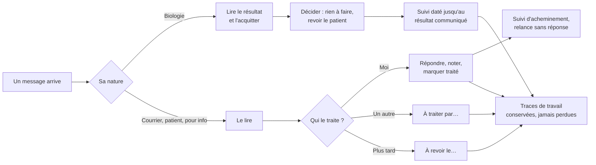

# E024 — Messagerie premium : traiter, déléguer, boucler

> **Statut** : 🟡 en cours — 2 features livrées et validées, 1 livrée en attente de validation humaine
> (task-459), 5 au backlog (tasks 454, 456, 457, 458, 462). Le 2026-11-12, toutes les features prévues avaient
> été retirées du backlog ; une partie y est revenue le 2026-11-13.
> **Version** : 0.3
> **Auteur** : PO forge (task-453)
> **Modèle** : task-driven
> **Dernière mise à jour** : 2026-11-13
> **Vue ingénierie** : [E024-Changelogs.md](E024-Changelogs.md)

---

<!-- toc:start — section générée par /tech-writer ; ne pas éditer manuellement -->

## Sommaire

- [1. Vision](#1-vision)
- [2. Objectifs métier](#2-objectifs-métier)
- [3. Acteurs concernés](#3-acteurs-concernés)
- [4. Features de l'EPIC](#4-features-de-lepic)
- [5. Workflow entre Features](#5-workflow-entre-features)
- [6. Règles métier transverses](#6-règles-métier-transverses)
- [7. Contraintes et hypothèses](#7-contraintes-et-hypothèses)
- [8. Critères d'acceptation de l'EPIC](#8-critères-dacceptation-de-lepic)
- [9. Hors périmètre](#9-hors-périmètre)
- [État de couverture (2026-11-13)](#état-de-couverture-2026-11-13)
- [Synthèse fonctionnelle des changelogs](#synthèse-fonctionnelle-des-changelogs)

<!-- toc:end -->

---

## 1. Vision

La messagerie ne se contente plus de recevoir et d'envoyer. Elle aide le cabinet à **traiter** ce qui arrive, à
**déléguer** ce qui revient à quelqu'un d'autre, et à **boucler** chaque échange jusqu'au bout : un résultat de
biologie acquitté puis communiqué au patient, un courrier envoyé dont on sait qu'il est arrivé et a été lu, une
demande restée sans réponse qui revient d'elle-même.

Tout ce que le cabinet décide sur un message — acquittement, « traité », report, attribution, note, suivi — est une
trace de travail. Ces traces appartiennent à la boîte, portent le nom de la personne qui les a posées, et ne
disparaissent jamais parce que le message a été rangé ailleurs, depuis la plateforme ou depuis un autre logiciel.

*Source : analyse fonctionnelle des manques de la messagerie du 2026-11-11.*

---

## 2. Objectifs métier

- Le praticien voit ce qui **reste à traiter**, pas seulement ce qui n'est pas lu.
- Le cabinet se **répartit** le travail d'une même boîte sans échange hors de la messagerie.
- Aucun résultat de biologie ne se perd entre sa lecture et sa communication au patient.
- Le praticien sait si son message est **arrivé**, a été **lu**, ou pourquoi il a **échoué**.
- Une trace de travail posée sur un message n'est **jamais perdue**, quoi qu'il arrive au message.

---

## 3. Acteurs concernés

- **Le médecin titulaire** de la boîte.
- **Les confrères membres** d'une boîte organisationnelle.
- **La secrétaire ou l'assistante délégataire**, qui travaille dans la boîte du médecin.
- **Le patient**, destinataire d'un envoi par Mon espace santé.
- **L'équipe produit**, qui suit la charge de la messagerie sans voir aucune donnée de santé.

---

## 4. Features de l'EPIC

> Le bilan d'avancement par feature (statut, couverture, tasks contributives) est consigné en fin de document, dans
> la section *État de couverture*.

| Fonctionnalité | Ce que le praticien peut faire | Tasks | Statut |
|---|---|---|---|
| Un acquittement ne disparaît jamais | Retrouver l'acquittement d'un compte rendu, sa note, son auteur et le patient rattaché à la main, même après que le message a été rangé depuis un autre logiciel, supprimé puis restauré, ou relu après un incident de la messagerie | task-453 | ✅ Livrée et validée |
| Le suivi commence à une date | Choisir, pour toute la boîte, la date à partir de laquelle les messages arrivés réclament un acquittement. Les comptes rendus anciens ramenés par une première synchronisation se consultent et s'acquittent sans rien réclamer, marqués « Antérieur au suivi » | task-466 | ✅ Livrée et validée |
| « Vous avez répondu à ce message le… » | Savoir, en ouvrant un message, qu'on y a déjà répondu, ou qu'un collègue de la boîte l'a fait, quand et combien de fois ; ouvrir la réponse ; repérer d'une icône les messages répondus dans la liste | task-459 | 🟡 Livrée, en attente de validation humaine |
| Vues par nature | Retrouver d'un coup d'œil la biologie, les courriers, les messages de patients et ceux reçus pour information | task-456 | ⏳ À faire |
| Marquer un message traité | Voir ce qui reste à traiter, pas seulement ce qui n'est pas lu, et marquer un message traité | task-454 | ⏳ À faire |
| « À traiter par » | Confier un message à une personne de la boîte | task-457 | ⏳ À faire |
| Notes internes | Laisser sur un message une note visible des seules personnes de la boîte | task-458 | ⏳ À faire |
| Relance sans réponse | Voir revenir un message resté sans réponse depuis plusieurs jours | task-462 | ⏳ À faire |

---

## 5. Workflow entre Features

> ⚠️ Vision d'origine. Sont au backlog : vues par nature, marquer traité, « À traiter par », notes, bandeau de
> réponse, relance. Restent retirés depuis le 2026-11-12 : « À revoir le », suivi d'acheminement, suivi de biologie.

Le parcours d'un message dans le cabinet, tel que l'EPIC l'envisageait :

Toutes les traces de travail de ce parcours reposent sur le socle posé par la première feature (task-453) : elles
restent attachées au document ou au message, même quand celui-ci est déplacé, purgé puis relu, ou supprimé puis
restauré.

Seuls les messages arrivés depuis la **date de début du suivi** de la boîte entrent dans ce parcours comme travail à
faire (task-466). L'historique ramené par une première synchronisation reste consultable et s'acquitte si le
praticien le souhaite, mais il n'encombre ni « Bio à acquitter » ni le tableau de bord.

---

## 6. Règles métier transverses

| Règle | Énoncé | Statut |
|---|---|---|
| Une trace de travail ne disparaît jamais | Un acquittement, un rattachement manuel ou un état de travail survit à tout ce qui fait disparaître puis revenir un message ; il est conservé, même invisible, tant que le même document ne revient pas | ✅ Implémenté pour l'acquittement et le rattachement manuel (task-453) |
| Rien d'inventé | Une trace n'est rendue à un message que si l'identité du document est certaine ; dans le doute (deux copies du même document), rien n'est rendu et la décision est tracée | ✅ Implémenté (task-453) |
| Une nouvelle version est un nouveau document | Une nouvelle version d'un compte rendu n'hérite pas des acquittements de l'ancienne | ✅ Implémenté (task-453) |
| Tout acte est imputé à son auteur réel | Chaque trace porte la personne qui l'a posée (titulaire, membre, délégataire), y compris quand elle revient sur un message rangé ailleurs ; ce que la plateforme fait seule est tracé comme acte système | ✅ Implémenté pour l'acquittement et le rattachement manuel (task-453) |
| Seul le nouveau réclame une action | Un message ne réclame une action (acquitter aujourd'hui, traiter demain) que s'il est arrivé depuis la date de début du suivi de la boîte, comparée à sa date d'arrivée réelle ; l'historique reste consultable et actionnable sans rien réclamer, même s'il revient après un incident de la messagerie | 🟡 Implémenté pour l'acquittement, en attente de validation (task-466) |
| La date de suivi est une donnée de la boîte | Toute personne rattachée à la boîte (titulaire, membre, délégataire) peut changer la date de début du suivi ; la date ne peut pas être dans le futur, et chaque changement est tracé au nom de son auteur, avec l'ancienne et la nouvelle date | 🟡 Implémenté, en attente de validation (task-466) |

---

## 7. Contraintes et hypothèses

- Les traces de travail appartiennent à la **boîte** : toutes les personnes rattachées à la boîte les voient (règle de
  la boîte partagée, EPIC E020).
- Le rattachement à la main d'un document à un patient n'est possible que pour un document **sans INS** ; un document
  porteur d'une INS suit l'identité de référence.
- Les traces sont conservées aussi longtemps que le journal d'accès aux données de santé.

---

## 8. Critères d'acceptation de l'EPIC

- [ ] Toutes les features du §4 sont livrées et validées par l'humain.
- [x] Un acquittement de biologie et un rattachement manuel survivent au rangement d'un message depuis un autre
      logiciel (vérifié automatiquement sur l'application mobile et sur l'application web, task-453).
- [ ] Le praticien voit, en ouvrant sa boîte, ce qui reste à traiter et par qui.

---

## 9. Hors périmètre

- **La mesure de la charge et de l'usage de la messagerie** (volumes, délais, personnes connectées, boîtes et
  délégataires, plages horaires) : abandonnée dans l'application le 2026-11-12, sur décision humaine. Elle sera
  produite plus tard **hors de l'application**, par un traitement planifié qui établit un rapport journalier.
- Les étiquettes d'un message : elles se recalculent lorsqu'il revient.
- Les marques « lu » ou « signalé » posées depuis un autre logiciel : sujet distinct.
- Les acquittements et rattachements manuels posés **avant** la mise en service de cette protection ne sont pas
  protégés : seuls les comptes rendus reçus ensuite le sont.

---

## État de couverture (2026-11-13)

| Feature | Statut | Couverture | Tasks contributives |
|---|---|---|---|
| Un acquittement ne disparaît jamais | ✅ Livrée et validée | 100 % | task-453 |
| Le suivi commence à une date | ✅ Livrée et validée | 100 % livré | task-466 |
| « Vous avez répondu à ce message le… » | 🟡 Livrée, en attente de validation humaine | 100 % (code) | task-459 |
| Vues par nature | ⏳ À faire | 0 % | task-456 |
| Marquer un message traité | ⏳ À faire | 0 % | task-454 |
| « À traiter par » | ⏳ À faire | 0 % | task-457 |
| Notes internes | ⏳ À faire | 0 % | task-458 |
| Relance sans réponse | ⏳ À faire | 0 % | task-462 |

**Couverture EPIC consolidée : 3 features livrées sur 8 retenues** (2 validées, 1 en attente de validation
humaine), 5 au backlog.

---

## Synthèse fonctionnelle des changelogs

### Fonctionnalités métier

- **v0.1 — Un acquittement ne disparaît jamais.** Quand un compte rendu de biologie acquitté est rangé depuis le
  webmail de l'opérateur, purgé puis relu après un incident de la messagerie, ou supprimé puis restauré, il revient
  avec son acquittement intact : action, note, auteur et heure d'origine. Il ne revient plus « à acquitter ». Le
  patient rattaché à la main à un document sans INS est retrouvé de la même façon (task-453).
- **v0.2 — Le suivi commence à une date.** Seuls les comptes rendus de biologie arrivés depuis la date de début du
  suivi de la boîte réclament un acquittement. Une première synchronisation qui ramène deux ans d'historique ne fait
  plus monter « Bio à acquitter » à plusieurs centaines. Un compte rendu ancien s'ouvre sur « Antérieur au suivi » et
  peut toujours être acquitté, sans jamais redevenir « à acquitter ». Le réglage « Suivre les messages arrivés depuis
  le … » est sur le web et sur le mobile (task-466).
- **v0.3 — « Vous avez répondu à ce message le… ».** En ouvrant un message, le praticien voit s'il y a déjà été
  répondu : « Vous avez répondu… », « {Prénom NOM} ({rôle}) a répondu… » quand c'est un collègue de la boîte, ou
  « Une réponse a été envoyée… » quand la réponse est partie d'un autre logiciel. Le bandeau donne la date, l'heure et
  le nombre de réponses, et « Voir la réponse » ouvre l'envoi. Une icône signale les messages répondus dans la liste,
  avec la même information au survol ou à l'appui long. Les accusés de lecture et les rapports de distribution ne
  comptent pas comme des réponses. Sur l'application web et sur l'application mobile (task-459).

### Conformité réglementaire

- **v0.1 — Imputabilité.** Un acquittement qui revient garde l'auteur réel qui l'avait posé, délégataire compris. Le
  fait de le rendre au message est tracé au journal comme acte de la plateforme, sans personne, sans INS ni nom de
  patient, et conservé aussi longtemps que les autres accès aux données de santé (task-453).
- **v0.2 — Changer la date de suivi est un acte tracé.** Le journal de la boîte dit qui a changé la date de début du
  suivi, quand, et de quelle date à quelle date, délégataire compris (task-466).
- **v0.3 — La réponse est imputée à la personne qui l'a écrite.** En boîte partagée, le bandeau nomme le délégataire
  ou le membre qui a répondu, jamais la boîte ni le titulaire à sa place (task-459).

### Sécurité

- **v0.1 — Aucune perte silencieuse.** Un message supprimé pour de bon ne détruit plus la trace de prise de
  connaissance d'un résultat. Dans le doute sur l'identité d'un document, la plateforme ne rattache rien et le trace
  (task-453).

### Technique / observabilité (sans impact utilisateur direct)

- **v0.1 — Socle commun des traces de travail.** Le modèle qui protège l'acquittement est celui que suivront tous les
  états de travail de l'EPIC (traité, report, attribution, notes, suivis). Un parcours automatique supplémentaire
  vérifie désormais ce cas sur les deux applications (task-453).
- **v0.2 — Date d'arrivée réelle.** La plateforme retient la date d'arrivée de chaque message sur le serveur de
  messagerie : un message ancien relu après un incident reste ancien. Un parcours automatique vérifie, sur les deux
  applications, qu'un compte rendu antérieur au suivi ne réclame rien et s'acquitte quand même (task-466).
- **v0.3 — Drapeau « répondu » sur le serveur de messagerie.** Une réponse envoyée par la plateforme pose le drapeau
  standard « répondu » sur le message d'origine, visible des autres logiciels. Un parcours automatique vérifie le
  bandeau sur les deux applications (task-459).

---

*Document vivant, reconstruit par la forge à chaque fin de cycle d'une task de l'EPIC.*
