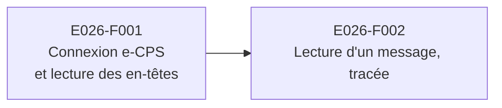

# E026 — Messagerie depuis un assistant IA (MCP)

> **Statut** : 🟡 En cours
> **Modèle** : task-driven
> **Version** : 0.1
> **Audience** : PO, médecins, direction, conformité
> **Dernière mise à jour** : 2026-11-13
> **Vue ingénierie** : [E026-Changelogs.md](E026-Changelogs.md)

<!-- toc:start — section générée par /tech-writer ; ne pas éditer manuellement -->

## Sommaire

- [1. Vision](#1-vision)
- [2. Objectifs métier](#2-objectifs-métier)
- [3. Acteurs concernés](#3-acteurs-concernés)
- [4. Features de l'EPIC](#4-features-de-lepic)
- [5. Workflow entre Features](#5-workflow-entre-features)
- [6. Règles métier transverses](#6-règles-métier-transverses)
- [7. Contraintes et hypothèses](#7-contraintes-et-hypothèses)
- [8. Critères d'acceptation de l'EPIC](#8-critères-dacceptation-de-lepic)
- [9. Hors périmètre](#9-hors-périmètre)
- [État de couverture (2026-11-13)](#état-de-couverture-2026-11-13)
- [Synthèse fonctionnelle des changelogs](#synthèse-fonctionnelle-des-changelogs)

<!-- toc:end -->

---

## 1. Vision

Le médecin interroge sa messagerie MSSanté depuis l'assistant IA de son choix (Claude ou tout assistant compatible) :
« quels comptes rendus sont arrivés ce matin ? », « retrouve les résultats de biologie de la semaine ». Il se connecte
une fois avec sa e-CPS, et l'assistant ne voit que ce que le médecin a le droit de voir, sans jamais rien modifier dans
sa boîte. Chaque consultation reste tracée à son nom, comme dans l'application.

---

## 2. Objectifs métier

*À compléter.*

---

## 3. Acteurs concernés

| Acteur | Rôle dans l'EPIC |
|--------|------------------|
| Médecin titulaire d'une boîte | Utilisateur principal : connecte son assistant IA et interroge sa messagerie |
| Délégataire, membre d'une boîte organisationnelle | Interroge les boîtes auxquelles il est rattaché, avec ses propres droits |
| Opérateur MSSanté | Garde la main sur l'accès : un accès suspendu par l'opérateur l'est aussi pour l'assistant |
| Éditeur de l'assistant IA | Reçoit les réponses de la messagerie : son usage des données est soumis à l'arbitrage du DPO et du RSSI |

---

## 4. Features de l'EPIC

> Le bilan d'avancement par feature (statut, couverture, tasks contributives) est consigné en fin de document, dans la
> section *État de couverture*.

| # | Fonctionnalité | Ce que le praticien peut faire | Tasks | Statut |
|---|---|---|---|---|
| E026-F001 | Connexion e-CPS et lecture des en-têtes | Connecter son assistant IA avec sa e-CPS, puis lui demander ses boîtes, ses dossiers, les messages reçus (expéditeur, objet, date, non lu) et lancer des recherches | task-478 | 🔵 Prêt, en attente de validation |
| E026-F002 | Lecture d'un message, tracée | Demander à l'assistant de lire ou de résumer un message : la lecture est tracée au nom du médecin, et le message reste non lu | task-479 | ⚪ À faire |

---

## 5. Workflow entre Features

**Description du workflow** :

1. **E026-F001** : le médecin ajoute la messagerie dans son assistant IA. Une page de connexion s'ouvre, nomme
   l'assistant qui demande l'accès et affiche un code à deux chiffres. Le médecin saisit son numéro RPPS, puis valide
   sur son téléphone la notification e-CPS qui porte le même code. L'assistant peut alors lister les boîtes, les
   dossiers et les messages, et rechercher, sans jamais rien modifier.
2. **E026-F002** : sur cette connexion, l'assistant pourra lire le contenu d'un message. Cette lecture attend une trace
   dédiée dans la messagerie, car aujourd'hui une consultation n'est tracée que lorsque le message passe à « lu ».

---

## 6. Règles métier transverses

| ID | Règle | Description | Statut |
|----|-------|-------------|--------|
| RG-E026-01 | Connexion par e-CPS seulement | Le médecin s'identifie par Pro Santé Connect avec sa e-CPS, en validant une notification qui porte le même code que la page. Aucun mot de passe. | 🔵 Prêt (task-478) |
| RG-E026-02 | L'assistant ne voit jamais les identifiants du médecin | L'assistant reçoit une autorisation propre à la messagerie, courte (15 minutes au plus), renouvelée tant que la session e-CPS est valide. Les identifiants du médecin restent sur le serveur, chiffrés. | 🔵 Prêt (task-478) |
| RG-E026-03 | Lecture seule | L'assistant ne peut rien envoyer, supprimer, déplacer ni marquer comme lu. | 🔵 Prêt (task-478) |
| RG-E026-04 | Mêmes droits que dans l'application | L'accès à une boîte dépend du rattachement du médecin et du verdict de l'opérateur MSSanté, exactement comme dans l'application. | 🔵 Prêt (task-478) |
| RG-E026-05 | Aucun contenu ni identité patient sans trace | L'assistant ne reçoit que des en-têtes : ni contenu, ni extrait, ni INS. La lecture d'un contenu n'arrivera qu'avec sa trace au nom du médecin. | 🔵 Prêt pour les en-têtes (task-478) |
| RG-E026-06 | Une lecture par l'assistant ne marque jamais le message comme lu | Un message lu par l'assistant reste non lu dans toutes les applications, pour que le médecin ne manque aucun message (une biologie anormale, par exemple). | ⚪ À faire (task-479) |
| RG-E026-07 | Clients autorisés seulement | Seuls les assistants enregistrés par la plateforme peuvent se connecter. Les demandes de connexion sont limitées, pour qu'aucune série de notifications e-CPS ne puisse viser un médecin. | 🔵 Prêt (task-478) |

---

## 7. Contraintes et hypothèses

### Contraintes
- Les réponses de la messagerie (objets et expéditeurs, qui peuvent nommer un patient) sortent vers l'éditeur de
  l'assistant IA. La mise en production attend l'arbitrage du DPO et du RSSI : contrat avec l'éditeur, hébergement HDS,
  secret médical, AIPD.

### Hypothèses
- Le médecin dispose d'une e-CPS active et d'un compte sur la plateforme (première connexion faite depuis
  l'application).

---

## 8. Critères d'acceptation de l'EPIC

- [ ] Toutes les Features sont implémentées et validées.
- [ ] L'arbitrage DPO / RSSI sur le partage de données avec l'éditeur de l'assistant est rendu.

---

## 9. Hors périmètre

- Toute action d'écriture depuis l'assistant : envoi, réponse, brouillon, déplacement, suppression, étiquette.
- Le contenu des pièces jointes.
- Les patients et les résultats de biologie en tant que tels : ils font l'objet d'autres travaux.

---

## État de couverture (2026-11-13)

| Fonctionnalité | Statut | Couverture | Tasks contributives |
|---|---|---|---|
| E026-F001 Connexion e-CPS et lecture des en-têtes | 🔵 Prêt, en attente de validation | Connexion, boîtes, dossiers, en-têtes et recherche | task-478 |
| E026-F002 Lecture d'un message, tracée | ⚪ À faire | — | task-479 |

---

## Synthèse fonctionnelle des changelogs

### Fonctionnalités métier
- v0.1 — Le médecin connecte son assistant IA à sa messagerie avec sa e-CPS et l'interroge en lecture seule : boîtes,
  dossiers, messages reçus, recherche (task-478).

### Conformité réglementaire
- v0.1 — Connexion par Pro Santé Connect (e-CPS), droits identiques à l'application, verdict de l'opérateur MSSanté
  respecté ; recherches tracées au nom du médecin (task-478).

### Sécurité
- v0.1 — Les identifiants du médecin ne quittent jamais le serveur et y sont chiffrés. Seuls les assistants enregistrés
  peuvent se connecter, et la page de connexion nomme celui qui demande l'accès. Les demandes de notification sont
  limitées (task-478).

---

*Documentation vivante générée par /tech-writer à partir des tasks de l'EPIC E026.*
