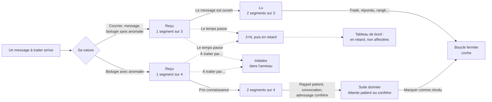

# E027 — Anneau de traitement : voir les boucles ouvertes

> **Statut** : 🟡 En cours — 1 feature livrée, en attente de validation (task-497) ; 3 au backlog (tasks 498, 499, 500).
> **Modèle** : task-driven
> **Version** : 0.1
> **Auteur** : PO forge (task-497)
> **Audience** : PO, médecins, secrétaires médicales, direction, conformité
> **Dernière mise à jour** : 2026-11-27
> **Vue ingénierie** : [E027-Changelogs.md](E027-Changelogs.md)

---

<!-- toc:start — section générée par /tech-writer ; ne pas éditer manuellement -->

## Sommaire

- [1. Vision](#1-vision)
- [2. Objectifs métier](#2-objectifs-métier)
- [3. Acteurs concernés](#3-acteurs-concernés)
- [4. Features de l'EPIC](#4-features-de-lepic)
- [5. Workflow entre Features](#5-workflow-entre-features)
- [6. Règles métier transverses](#6-règles-métier-transverses)
- [7. Contraintes et hypothèses](#7-contraintes-et-hypothèses)
- [8. Critères d'acceptation de l'EPIC](#8-critères-dacceptation-de-lepic)
- [9. Hors périmètre](#9-hors-périmètre)
- [Annexe — Sources documentaires](#annexe--sources-documentaires)
- [État de couverture (2026-11-27)](#état-de-couverture-2026-11-27)
- [Synthèse fonctionnelle des changelogs](#synthèse-fonctionnelle-des-changelogs)

<!-- toc:end -->

---

## 1. Vision

Chaque message qui attend une action porte un **anneau incomplet**. Chaque étape franchie remplit un segment, le vide
montre ce qui reste à faire, et l'anneau se ferme d'une coche quand le message est traité. Le médecin ne gère plus des
messages : il gère des **boucles ouvertes**.

D'un regard sur sa liste, le praticien, sa secrétaire ou son confrère voit où en est chaque message, à qui il est
confié, s'il porte une anomalie de biologie et, à terme, depuis combien de temps il attend. L'anneau n'invente rien :
il dessine ce que la boîte sait déjà (lu, traité, attribué, acquitté), pour toutes les personnes qui y travaillent.

*Source : demande du product owner du 2026-11-27 et phase de conception validée le même jour
([spécification](../specs/anneau-de-traitement/specification.md), variante D des
[maquettes](../specs/anneau-de-traitement/maquettes.html), [revue de design](../specs/anneau-de-traitement/revue-design.md)).*

---

## 2. Objectifs métier

- Le praticien voit d'un regard **où en est** chaque message qui attend une action, sans l'ouvrir.
- Dans une boîte partagée, chacun voit **à qui** un message est confié, et ce que **personne n'a pris**.
- Un compte rendu de biologie anormal se repère par sa **gravité** jusqu'à sa résolution, et l'anomalie reste visible
  une fois la boucle fermée.
- Ce qui **traîne** se voit avant de devenir un oubli, avec des seuils adaptés à la gravité : quelques heures pour une
  valeur critique, quelques jours pour un courrier.
- Le tableau de bord dit ce qui est **en retard** et ce qui n'est **affecté à personne**, et y mène d'un geste.

---

## 3. Acteurs concernés

| Acteur | Rôle dans l'EPIC |
|--------|------------------|
| Médecin titulaire de la boîte | Utilisateur principal : suit ses boucles ouvertes, confie des messages, acquitte la biologie |
| Secrétaire ou assistante délégataire | Travaille dans la boîte du médecin : voit les mêmes anneaux, reconnaît d'un fond plein les messages qui lui sont confiés |
| Confrère membre d'une boîte organisationnelle | Partage les mêmes boucles que les autres personnes de la boîte |
| Laboratoire de biologie | Pose l'anomalie ou la valeur critique sur le compte rendu ; l'anneau en reprend la gravité, sans jamais la recalculer |
| Patient, confrère destinataire | Le tiers dont la boucle attend la réponse après un rappel, une convocation ou un adressage |

---

## 4. Features de l'EPIC

> Le bilan d'avancement par feature (statut, couverture, tasks contributives) est consigné en fin de document, dans
> la section *État de couverture*.

| Fonctionnalité | Ce que le praticien peut faire | Tasks | Statut |
|---|---|---|---|
| L'anneau dans la liste et le détail | Voir, à la place de l'initiale de l'expéditeur, un anneau qui dit l'étape atteinte par chaque message à traiter : trois étapes pour un courrier (reçu, lu, traité), quatre pour un compte rendu de biologie à acquitter (reçu, pris connaissance, suite donnée, résolu). Lire au centre les initiales de la personne à qui le message est confié, sur fond plein quand c'est soi ; lire à droite « Non affecté », « Attente patient » ou « Attente confrère ». Reconnaître la gravité à la couleur, ambre pour une anomalie, rouge pour une valeur critique. Ouvrir le message et trouver l'anneau, les étapes datées et signées, et les boutons d'acquittement rangés par étape : dans la section « Traitement » du panneau latéral sur le web, en tête du message sur le mobile. Revenir à l'icône classique si on le préfère | task-497 | 🟡 Livrée, en attente de validation |
| Une ligne de liste allégée | Lire une ligne qui ne dit que l'utile : plus de « Non affecté » ni d'identifiant écrits, le nombre de messages d'une conversation en pastille grise sur l'anneau, la réponse envoyée en icône au bord de l'anneau, deux valeurs de biologie au plus puis « +N », une seule date, moins de puces redondantes | task-500 | ⏳ À faire |
| Ancienneté et légende des anneaux | Voir depuis combien de temps une boucle est ouverte (« J+N », ou « H+N » pour une valeur critique) dès le premier seuil, et « en retard » au dernier ; régler les seuils de la boîte ; choisir les signes affichés ; ouvrir une légende qui dessine chaque état | task-498 | ⏳ À faire |
| Tableau de bord : boucles en retard et non affectées | Lire sur les tuiles du tableau de bord « dont N en retard » et le nombre de messages que personne n'a pris, puis ouvrir d'un geste la liste correspondante | task-499 | ⏳ À faire |

---

## 5. Workflow entre Features

Le parcours d'un message à traiter, tel que l'anneau le montre :

Les traits pleins sont livrés (task-497). Les traits pointillés vers l'ancienneté et le tableau de bord sont au
backlog.

### Lire un anneau

| Ce que le praticien voit | Ce que cela veut dire |
|---|---|
| Segments pleins et traits fins | Les étapes franchies, et celles qui restent |
| Une coche dans un cercle fin | La boucle est fermée : le message est traité |
| Un cercle en pointillé | Hors suivi : message « Pour info », accusé, message antérieur à la date de début du suivi. Aucune action n'est attendue |
| Des initiales au centre | Le message est confié à cette personne ; sur fond plein, il vous est confié ; barrées, la personne n'a plus accès à la boîte |
| « Non affecté » à droite | Le message attend une action et personne ne l'a pris. Ce signe n'apparaît que dans une boîte d'au moins deux personnes |
| « Attente patient », « Attente confrère » | La suite est entre les mains d'un tiers, après un rappel, une convocation ou un adressage |
| Anneau ambre ou rouge | Un compte rendu avec anomalie (ambre) ou avec valeur critique (rouge) reste à acquitter |
| Un ⚠ atténué sur une ligne fermée | L'anomalie demeure, même une fois la boucle fermée |

L'état de chaque anneau s'écrit en clair au survol sur l'application web et à l'appui long sur l'application mobile,
par exemple : « Courrier. Étape 2 sur 3 : lu ; reste : traité. À traiter par … ». Ce texte ne cite jamais le patient.

### Dans la liste

L'anneau prend la place de l'initiale de l'expéditeur, à gauche de la ligne. Les signes « non lu » (gras, point)
restent. La pastille d'initiales et la pastille « Traité » disparaissent de la ligne : l'anneau les porte. Dans
Envoyés, Brouillons et Corbeille, la ligne garde l'initiale de l'expéditeur. Le badge ⚠ du nombre de comptes rendus à
acquitter reste à droite, inchangé (task-497).

### Dans le détail

Sur l'application web, le bloc de l'anneau est la première section, « Traitement », du panneau « Actions & dossier » :
il ne charge pas la lecture du message. Panneau replié, son icône porte une pastille tant qu'un compte rendu reste à
acquitter ; la puce « Acquittement à traiter » de l'en-tête et l'avis « ce compte rendu reste à acquitter » ouvrent la
section (décision du 2026-11-27). Sur l'application mobile, qui n'a pas de panneau latéral, le bloc est en tête du
message. Il montre un anneau et la liste de ses étapes : « Reçu » avec sa date d'arrivée, « Lu », « Traité par …
le … » avec le geste, et chaque acquittement avec son auteur et sa date. Pour un compte rendu à acquitter, les boutons
sont juste sous l'anneau, rangés par étape : « Pris connaissance » ; « Rappel patient », « Convocation », « Adressage
confrère » ; « Marquer comme résolu ». La fenêtre de confirmation et la note ne changent pas. Un message qui porte
plusieurs comptes rendus à acquitter montre un anneau et ses boutons par compte rendu ; dans la liste, le moins avancé
commande l'anneau. « Traité », « Remettre à traiter » et « À traiter par » restent à leur place habituelle (task-497).

### En direct, pour toute la boîte

Chaque geste remplit son segment par une courte transition. Un acquittement, même intermédiaire, met à jour l'anneau
chez les autres personnes connectées à la boîte, sans rechargement, comme « Traité » et l'attribution (task-497).

### Préférence d'affichage

Dans les Paramètres, chaque personne choisit « Affichage de la liste : Anneau de traitement » (par défaut) ou « Icône
classique ». En icône classique, la liste redevient celle d'avant, pastilles comprises ; le bloc du détail ne change
pas. Ce choix est propre à chaque personne et revient à la réouverture (task-497).

---

## 6. Règles métier transverses

| Règle | Énoncé | Statut |
|---|---|---|
| L'anneau dessine, il n'ajoute rien | L'anneau représente des états que la boîte connaît déjà : lu, traité, attribué, acquitté. Aucun état nouveau n'est saisi, aucun acte nouveau n'est créé ; chaque geste qui le fait avancer reste tracé comme avant, au nom de la personne qui l'a fait | 🟡 Implémenté, en attente de validation (task-497) |
| Qui a un anneau | Un message à traiter a un anneau ouvert ; un message traité, un anneau fermé. Les messages « Pour info », les accusés, les rapports et les messages arrivés avant la date de début du suivi sont hors suivi. Envoyés, Brouillons et Corbeille n'ont jamais d'anneau | 🟡 Implémenté, en attente de validation (task-497) |
| Les étapes suivent le geste réel | Un courrier passe par reçu, lu, traité. Un compte rendu de biologie à acquitter passe par reçu, pris connaissance, suite donnée, résolu : l'étape suit la dernière action, et une action peut en sauter une. Le compte rendu le moins avancé commande l'anneau de la liste | 🟡 Implémenté, en attente de validation (task-497) |
| La couleur ne dit que la gravité clinique | Neutre sans compte rendu à acquitter, ambre pour une anomalie, rouge pour une valeur critique, telles que le laboratoire les a posées. Aucun état ne repose sur la seule couleur : segments, coche, pointillé, initiales et texte suffisent en niveaux de gris | 🟡 Implémenté, en attente de validation (task-497) |
| Fermer la boucle n'efface pas l'anomalie | Un message traité ou hors suivi qui porte une anomalie garde un ⚠ atténué | 🟡 Implémenté, en attente de validation (task-497) |
| À qui le tour se lit dans l'anneau | Les initiales de la personne à qui le message est confié sont au centre de l'anneau, sur fond plein pour soi, barrées si l'accès est retiré. « Non affecté » ne s'affiche que dans une boîte d'au moins deux personnes actives | 🟡 Implémenté, en attente de validation (task-497) |
| L'état en clair ne nomme jamais le patient | Le texte de l'anneau décrit l'étape et la personne responsable, jamais le patient, son INS ni une valeur de biologie | 🟡 Implémenté, en attente de validation (task-497) |
| L'anneau appartient à la boîte | Titulaire, délégataire et membre voient les mêmes anneaux, mis à jour en direct. Seul le fond plein des initiales dépend de la personne qui regarde. Une personne sans accès ouvert par l'opérateur ne voit rien | 🟡 Implémenté, en attente de validation (task-497) |
| L'affichage est un choix personnel | Le choix entre anneau et icône classique appartient à la personne et n'est pas tracé | 🟡 Implémenté, en attente de validation (task-497) |
| Les seuils d'ancienneté appartiennent à la boîte | Trois seuils par catégorie (valeur critique en heures, biologie et courrier en jours), réglables par toute personne active de la boîte ; chaque changement est tracé au nom de son auteur, avec les anciennes et les nouvelles valeurs | ⏳ À faire (task-498) |
| L'ancienneté part de l'ouverture de la boucle | Elle se compte en jours calendaires depuis l'arrivée du message, ou depuis « Remettre à traiter » s'il a été rouvert ; une boucle fermée ou hors suivi n'en affiche jamais | ⏳ À faire (task-498) |
| « En retard » veut dire la même chose partout | Le tableau de bord et la liste comptent les mêmes boucles en retard, selon les seuils de la boîte | ⏳ À faire (task-499) |

---

## 7. Contraintes et hypothèses

### Contraintes

- **« Lu » est partagé par la boîte.** Le segment « lu » veut dire « lu par une personne de la boîte », pas forcément
  par soi. L'étape « Lu » du détail s'affiche sans date ni auteur.
- **La gravité dépend du codage du laboratoire.** Certains codes d'anomalie ne sont pas encore reconnus par la
  messagerie (task-467) : tant que ce travail n'est pas livré, un anneau peut rester neutre sur un compte rendu
  anormal. Le compte rendu lui-même, et son ⚠ quand il est reconnu, restent la référence.
- **Hors ligne**, l'anneau se dessine sur les données gardées sur l'appareil ; le détail ne montre pas l'historique
  des acquittements.

### Hypothèses

- La variante D a été retenue par le product owner sans l'épreuve auprès de trois à cinq médecins que recommandait la
  revue de design. Le risque principal relevé est qu'un rond portant des initiales se lise comme l'expéditeur ; le
  texte au survol, et demain la légende (task-498), le couvrent.

---

## 8. Critères d'acceptation de l'EPIC

- [ ] Toutes les features du §4 sont livrées et validées par l'humain.
- [x] Le praticien voit d'un regard où en est chaque message à traiter, à qui il est confié et s'il porte une anomalie
      de biologie (vérifié automatiquement sur l'application mobile et sur l'application web, task-497).
- [ ] Le praticien voit depuis combien de temps chaque boucle est ouverte, et lesquelles sont en retard (task-498).
- [ ] Le tableau de bord dit ce qui est en retard et ce que personne n'a pris, et y mène d'un geste (task-499).

---

## 9. Hors périmètre

- **Les messages envoyés** : leur acheminement et l'attente d'une réponse n'ouvrent pas de boucle dans cet EPIC.
- **Une étape « patient vu »** : elle demanderait une donnée clinique nouvelle à saisir et à tracer. Les étapes de la
  biologie suivent l'acquittement existant.
- **Des règles propres à chaque personne** pour décider qu'un message n'attend rien : la règle de la boîte (« Pour
  info », accusés, rapports, messages antérieurs au suivi) s'applique à tous.
- **Une tuile unique « Boucles ouvertes »** au tableau de bord : elle doublerait « À traiter », « Pour moi » et « Bio à
  acquitter ». Les tuiles existantes s'enrichissent, et une tuile « Non affectées » s'ajoute (task-499).
- **Les codes visuels écartés par la revue de design** : pointe et sens de rotation, balle, cernes d'ancienneté.
- **L'application Blazor** : les fonctions de suivi du travail n'y existent pas.

---

## Annexe — Sources documentaires

- [Spécification fonctionnelle de l'anneau de traitement](../specs/anneau-de-traitement/specification.md) : règles,
  machines à états, ancienneté, gravité, droits, cas particuliers, décisions du 2026-11-27.
- [Maquettes](../specs/anneau-de-traitement/maquettes.html) : quatre variantes sur les mêmes données ; la variante D est
  la référence visuelle.
- [Revue de design](../specs/anneau-de-traitement/revue-design.md) : revue contradictoire des variantes et origine de la
  variante D.
- EPIC E024 *Messagerie premium : traiter, déléguer, boucler* : les états que l'anneau représente (traité, « À traiter
  par », acquittement, date de début du suivi).

---

## État de couverture (2026-11-27)

| Feature | Statut | Couverture | Tasks contributives |
|---|---|---|---|
| L'anneau dans la liste et le détail | 🟡 Livrée, en attente de validation | 100 % livré sur l'application web et l'application mobile | task-497 |
| Ancienneté et légende des anneaux | ⏳ À faire | 0 % | task-498 |
| Tableau de bord : boucles en retard et non affectées | ⏳ À faire | 0 % | task-499 |
| Une ligne de liste allégée | ⏳ À faire | 0 % | task-500 |

**Couverture EPIC consolidée : 1 feature livrée sur 4**, en attente de validation ; 3 au backlog.

---

## Synthèse fonctionnelle des changelogs

### Fonctionnalités métier

- **v0.1 — L'anneau dans la liste et le détail.** Chaque message à traiter porte, à la place de l'initiale de
  l'expéditeur, un anneau qui dit son étape : trois segments pour un courrier (reçu, lu, traité), quatre pour un compte
  rendu de biologie à acquitter (reçu, pris connaissance, suite donnée, résolu). Une coche ferme la boucle ; un cercle
  en pointillé signale un message qui n'attend rien. Les initiales de la personne à qui le message est confié sont au
  centre de l'anneau, sur fond plein pour soi ; « Non affecté », « Attente patient » et « Attente confrère » s'écrivent
  à droite. L'anneau est ambre pour une anomalie, rouge pour une valeur critique, et un ⚠ atténué reste sur une boucle
  fermée. Le détail montre l'anneau, les étapes datées et signées, et les boutons d'acquittement rangés par étape juste
  en dessous : dans la section « Traitement » du panneau latéral sur l'application web (décision du 2026-11-27, pour
  ne pas alourdir la lecture), en tête du message sur l'application mobile. Chacun peut revenir à l'icône classique.
  Sur l'application web et sur l'application mobile (task-497).

### Conformité réglementaire

- **v0.1 — Aucun acte nouveau, chaque étape reste imputée.** Lire, traiter, attribuer et acquitter restent tracés
  comme avant, au nom de la personne réelle, délégataire compris ; afficher un anneau n'est pas un acte. En boîte
  partagée, un acquittement posé par un délégataire apparaît chez le titulaire avec le délégataire pour auteur
  (task-497).

### Sécurité

- **v0.1 — Rien du patient dans les signes de l'anneau.** Le texte en clair de l'anneau et les mises à jour en direct
  envoyées aux autres personnes de la boîte ne portent ni nom de patient, ni INS, ni valeur de biologie (task-497).

### Technique / observabilité (sans impact utilisateur direct)

- **v0.1 — Une liste aussi rapide qu'avant.** L'étape d'acquittement de chaque message est calculée dans la lecture
  existante de la page de liste, sans requête de plus vers la base ; aucun état d'anneau n'est stocké. Un acquittement
  intermédiaire prévient désormais en direct les autres personnes connectées. Quatre parcours automatiques vérifient
  l'anneau du courrier, celui de la biologie, l'affectation en boîte partagée et le choix de l'icône classique, sur les
  deux applications (task-497).

---

*Document vivant, reconstruit par la forge à chaque fin de cycle d'une task de l'EPIC.*
